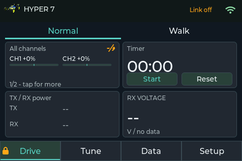
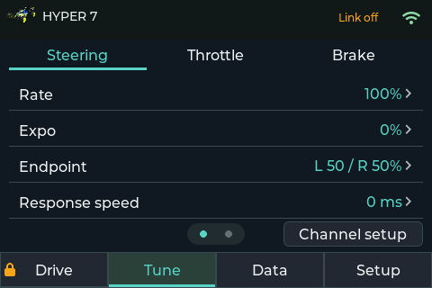
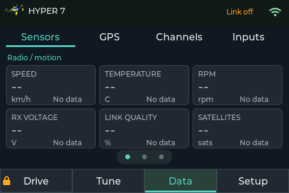
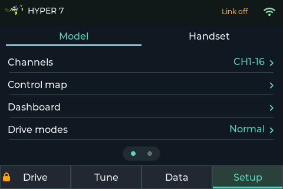
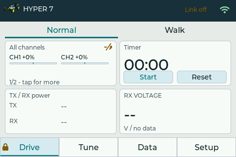
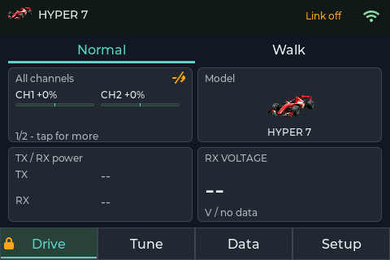

# JR R-1 EVO

**A new computer for a favourite old radio: custom ESP32-S3 transmitter firmware, a replacement PCB, colour touchscreen, and ExpressLRS with S.Port sensor telemetry.**

<p align="center">
  
  <br><em>The working R-1 EVO, photographed on 31 October 2026.</em>
</p>

The aim is to keep what makes the JR PROPO R-1 enjoyable to use—its pistol grip,
steering wheel, trigger, trims and physical buttons—while replacing the ageing
computer and radio system with electronics and software we can develop ourselves.
The result is an ongoing, working conversion rather than a new transmitter shell:
a custom PCB inside the R-1, a Seeed XIAO ESP32-S3, a 3.5-inch touchscreen and a
RadioMaster Ranger Nano running ExpressLRS.

The project covers **both ends of the link**: independently developed handset
firmware in this repository and a customised ExpressLRS receiver firmware fork
that adds direct FrSky S.Port sensor support. The handset software is **not an
OpenTX or EdgeTX fork**. It implements its own control pipeline, model settings,
LVGL interface and CRSF integration; the RF link relies on ExpressLRS.

[Prototype build and history](docs/build-history.md) · [Features](#what-we-have-built) ·
[Simulator](#the-same-ui-on-the-desktop) · [Web UI](#the-web-ui-inside-the-transmitter) ·
[Schematics](#hardware-and-schematics) · [Development guide](DEVELOPMENT.md)

## What we have built

This describes the development prototype as of **1 November 2026**. Features
have been built and exercised incrementally; this is not a finished commercial
radio or a claim that every sensor/hardware combination has been validated.
Recent development is also tracked on
[`codex/safety-control-refactor`](https://github.com/cmlpreston/jr-r1-native-crsf/tree/codex/safety-control-refactor).

| Area | Implemented in the prototype |
| --- | --- |
| Controls and outputs | Native 16-channel CRSF output; original steering, throttle, trims, grip controls, switches and eight-button keypad; configurable control assignments and channel roles. |
| Tuning and mixing | Reversal, calibration, trims, rates, expo, independent endpoints, response speed, channel-to-channel mixes, switch conditions and graphs showing the resulting response. |
| Models | Saved model configurations, names, selectable vehicle artwork and primary/accent/base colour choices, including an F1-style car. |
| Dashboard | Configurable widgets in 1×1, 2×1, 1×2 and 2×2 sizes; analogue channel bars, binary switch states, selectable physical inputs, speed dial, lap/stopwatch/countdown timer, power readings and a combined battery-cell panel. |
| Telemetry | CRSF link and sensor decoding, freshness/no-data handling, history views and alarms; custom receiver integration for S.Port cells and FAS sensor measurements. S.Port GPS forwarding is prepared for hardware validation. |
| Maps | Address search, pan/zoom and selection of street or satellite imagery in the browser; image packages stored on the handset, GPS trail overlay and a map view that hides its controls when idle. |
| Operating modes | CUT/re-arm workflow with readiness reasons, Normal/Walk selection, PIN-protected exit from Walk, boot PIN and USB PIN recovery. |
| Module link | Prepared CRSF enable/pause control with physical approval after TX battery detection; approval expires on power loss or reboot. Installed Ranger RF shutdown still needs validation. |
| Connectivity | Saved home Wi-Fi with automatic connection/retry, optional setup hotspot, configurable hostname and onboard configuration/remote-control web UI. |
| Development tools | Shared-code desktop/browser simulator, screenshot and layout checks, host tests, boot logs, memory diagnostics, serial input monitor and local-build/Pi-USB flashing workflow. |

The channel monitor can show live control positions while CUT holds transmitted
outputs safe. A display value is therefore not, by itself, proof of servo output.
The transmitter's CUT state also does not replace receiver/ESC failsafe setup.

### Channel setup and hardware-control mapping

Configuration is organised around the output channel and the physical control
that drives it. Steering/throttle roles can be assigned to different CRSF
channels; they are not permanently tied to CH1 and CH2.

| Configuration | Available settings |
| --- | --- |
| Per-channel response | Normal/reversed direction; separate negative/positive endpoints, rates, expo and response times; trim and subtrim; channel setup linked to its control assignment. |
| Physical-input calibration | Steering/trigger calibration and neutral handling belong to the physical input; output travel/endpoints belong to the channel. |
| Mix sources | Two independently enabled mix contributions per destination; physical inputs, CH1–16, or configured steering/throttle as sources; include the existing channel input or use mixes only. |
| Mix calculation | Add or replace; positive/negative weights; follow source trim; constant contribution; final minimum/maximum; auxiliary-channel CUT value; reset to default settings. |
| Mix activation | Always, selected switch low/high, Walk or Normal; proportional source or above/below threshold with trigger point and hysteresis. |
| Switched rates | Select a physical switch; independent negative/positive rates for low and high positions, with configurable transition time. |
| Mix preview | Contribution/output bars and a response graph; sweep an input and inspect switch/mode effects without transmitting the preview. |
| Control assignment | Enable/disable; select a supported transmitter function, model parameter, drive-mode action or CRSF output; choose the channel/parameter and when the binding applies. |
| Control behaviour | Proportional, momentary, toggle, two-position, spring-return three-position, stepped, three-position selector or pulse, as appropriate to the chosen control and target. |
| Assignment range/state | Minimum/maximum, step, reverse control, initial and safe values, pulse duration and retained state where supported. |
| Assignment context | Always, dashboard, menus, CUT only or armed only. Unavailable combinations are rejected rather than silently assigned. |
| Monitor visibility | Choose channels/physical controls shown in All Channels, including timer switch and grip trims; horizontal or vertical analogue bars, binary indicators for suitable switch assignments. |

A practical mix example is **throttle → CH3 gyro gain**: start with a constant
gain, add a negative throttle contribution, and limit the final gain range so
it stays on the intended side of the gyro's mode boundary. A switch can enable
the mix or select rates. This configures the receiver's gain channel; the
handset does not itself implement a vehicle stabilisation gyro.

### Other configuration areas

- **Models and dashboard:** model selection/name, vehicle image and three
  colours; widget type, size, position and display options. Enlarging a widget
  preserves obscured widgets for when it shrinks again.
- **Drive and timer:** Normal/Walk and forward Walk limit; deliberate CUT/re-arm;
  per-model Up/Down/Lap timers, lap history, alarms and timer-control assignments.
  Output-enabling operations require neutral and fresh inputs/link.
- **Telemetry and battery:** selectable sensor widgets and histories, battery
  chemistry/cell-count/alarm settings, transmitter voltage sensing, vehicle-cell
  widget Auto or expected 1S–12S, and stale/missing-data indication. Expected
  cell count does not estimate individual cell voltages from pack total.
- **ExpressLRS module:** device discovery, supported module-provided settings,
  bindphrase/UID workflow and parameter readback. Packet rate, telemetry ratio,
  power and other choices depend on the connected module's advertised parameters.
- **Maps:** street/satellite style, address/location, zoom and download area,
  map name/source attribution, import/export/upload and storage preparation;
  map zoom, trail visibility/reset and fullscreen controls on the handset.
- **Handset:** display orientation, colour scheme, brightness/night behaviour,
  screensaver, PIN change/recovery, input calibration, saved Wi-Fi connection,
  automatic connection option, setup hotspot, hostname and software restart.

Some source enums and prototype menus reserve future actions such as macros,
logging or ESC programming. Their presence in code is not a claim that those
features are complete. Per-receiver output mapping and failsafe configuration
also remain distinct from transmitter channel setup.

## The Drive dashboard: choose what matters for each model

Each model has its own two-column, two-row widget layout. Open **Setup → Model →
Dashboard**, choose a position, then select the widget type, size, style and
source and **Apply**. The resulting widgets appear on **Drive**. Sizes are 1×1,
2×1, 1×2 and 2×2, where they fit from the selected position. A larger widget
covers neighbouring widgets without deleting their saved configuration; reducing
it reveals them again. Use **Empty** to leave a position unused.

| Widget | What it shows and how it can be configured |
| --- | --- |
| **Timer** | Per-model stopwatch, countdown or current lap, with Start/Lap/Pause and Reset controls. Larger widgets show last and best laps. Tap its title/time area for timer controls, settings and lap history; supported handset assignments also operate it. |
| **TX / RX power** | Transmitter-pack voltage from the local ADC and receiver supply from telemetry. Choose numbers, bars or dials. These are separate measurements, not the vehicle's individual cell voltages. |
| **Channels** | One chosen channel and an optional second channel. Choose numbers, bars, dials, graph or switch-style presentation. Useful for focusing on steering/throttle or an auxiliary output. |
| **All channels** | Configured channels, physical hardware inputs, or both. Choose which entries appear; analogue values use horizontal/vertical bars or numeric presentation, while suitable binary inputs use switch indicators. Tap to page through entries that do not fit. This can include the timer switch, grip trims and other connected controls; the unwired DISPLAY_SW is not an active input. |
| **Sensor — speed** | Current, maximum or average speed as the large reading, with related statistics. Choose numbers, a dial or graph. Speed requires the relevant vehicle/GPS telemetry; the handset does not infer it from throttle position. |
| **Sensor — other readings** | Temperature, RPM, receiver voltage, link quality, satellite count, drive-pack total, lowest cell, FAS voltage or FAS current. Choose the supported numeric/graph style. Missing or stale readings display as unavailable rather than zero. |
| **Battery cells** | All reported vehicle cells in one widget, with pack total, lowest cell and detected count. Choose Auto or an expected 1S–12S count. Tap to page if needed. The present receiver cell trial forwards 4S; larger UI capacity does not imply larger-pack receiver validation. |
| **GPS map / trail** | A north-up saved street/satellite image or vector map, with vehicle position and recorded GPS trail overlaid when telemetry is available. The map fills the widget with a north indicator and attribution. Tap for the larger GPS page, zoom and trail controls; controls hide when idle and reappear on touch. |
| **Model image** | Current model's name and selected vehicle artwork, with configurable primary, accent and base paint colours. Tap to reach model selection. |
| **Empty** | No widget in that position. |

Tap a sensor for its detail/history view, the power widget for radio diagnostics,
or a map for the GPS view. Styles are filtered to suit the widget: for example,
the speed dial is not offered for an arbitrary temperature sensor.

Channel widgets remain useful while outputs are CUT: they show **requested
control positions**, with a small crossed-out output indicator. Data's channel
monitor distinguishes requested values from the actual safe values sent.

## CUT, Normal/Walk and PIN protection

**CUT inhibits live control output; it does not turn off the RF module. While
the module link is enabled, CRSF channel frames continue.** The control/transport
safety layers send configured safe values instead of the live requested values. Auxiliary CUT overrides can be
configured separately; they are not receiver RF-loss failsafe settings.

A separate **Module link** control is prepared for bench validation. CRSF
communication defaults off at every boot. Detecting a stable TX battery feed
prompts for physical approval; choosing Cancel keeps communication paused.
Approval starts communication while leaving outputs CUT, so enabling the
module link and enabling live controls remain separate actions. Hold the
LQ/status area to reopen the dialog, or use Output status → Module link.

Pausing requires CUT first. Loss of the sensed supply or a reboot revokes
approval; it is not saved for the next power session. TX voltage sensing must
be enabled. The pause covers both CRSF channel frames and module-management
traffic, while the handset UI and web configuration remain available.

This is not a hardware power switch. The reviewed ExpressLRS firmware stops
its normal RF transmission timer after handset-link timeout, but that behaviour
still needs checking on the installed Ranger. Pausing CRSF must not be treated
as verified RF silence; guaranteed RF-off requires switched module power.

The transmitter starts with outputs inhibited. CUT is also used for structural
channel/mix/control edits, model and mode changes, calibration, hardware recovery
and remote interactions that need to enter configuration safely. Faults such as
invalid inputs/configuration or a stale control update keep outputs inhibited.
Ordinary navigation is separate from output enable; changing pages is not an
instruction to arm.

The **Drive** navigation control carries the output-state icon. Deliberately
hold it to request enabling, then release as prompted. The readiness view
explains blockers such as **Link wait** or **neutral required**. Enabling needs
the expected valid inputs/configuration, startup readiness, a qualifying link
and neutral throttle. Holding Drive also protects an intentional return to CUT
from an accidental tap. Unlocking a PIN never arms the transmitter.

**Normal** uses the configured output response. **Walk** limits physical forward
throttle to a configurable percentage (35% by default), while retaining the
configured brake/reverse authority. Mode selection is integrated into Drive;
changing mode forces CUT and requires deliberate re-arm at neutral. Leaving
Walk requires the PIN again. An abandoned Walk-exit PIN prompt times out after
10 seconds, returns to Drive and leaves Walk/CUT in force.

The LCD UI has a **boot PIN**, automatic submission when the correct four digits
are entered, PIN change and a **Forgot PIN?** USB recovery guide. The initial
trial PIN is `1234` and can be changed. Web access has its own authentication:
authenticated configuration can be available while the handset PIN is locked,
and the mirrored LCD supports PIN entry. These are separate access states.
A PIN unlock does not bypass output readiness or receiver/ESC failsafe setup.

Loss of the return telemetry link after arming is currently advisory; receiver
RF-loss behaviour remains the receiver's responsibility. CUT is a transmitter
control feature, not a substitute for configuring and testing that failsafe.

## Retaining and assigning the original hardware controls

We retain the R-1's wheel, trigger, trims, grip controls, switches and eight
keypad buttons. Their identities are separated from GPIO wiring, so control
assignment is not dictated by the label printed on the old case. The Control
map associates supported inputs with channels, transmitter functions, model
parameters or drive-mode actions, with behaviour, ranges and context settings.
For example, a suitable switch can operate an auxiliary channel and a trim can
adjust a channel parameter rather than its original R-1 function.

**Current keypad limitation:** the latest navigation implementation reserves
MODE/PAGE/SELECT/CLEAR/UP/DOWN/+/- before the assignment resolver. Although the
catalogue/web editor includes these buttons, using MODE as a general RF-channel
button requires a further precedence/remapping change. This is an intended
extension, not a capability claimed by the current screenshots.

## A look around the interface

These are **captures from the running XIAO handset**, taken over USB on
1 November 2026 from firmware `7d13dbf`. They contain the actual native
480×320 LVGL pixels sent toward the installed Waveshare LCD, rather than
simulator output. They are rendered screenshots, not photographs or physical
LCD readback. Outputs remained CUT and the module link stayed paused throughout;
unavailable sensor readings are shown honestly as no data.

| Drive: configurable dashboard | Tune: steering, throttle and brake |
| --- | --- |
|  |  |
| Data: sensors and telemetry | Setup: model configuration |
|  |  |

| Light colour scheme | Formula / F1 model artwork |
| --- | --- |
|  |  |

The [screen gallery](docs/ui-gallery.md) includes all five colour schemes,
eight vehicle artwork choices, primary/accent/base paint, channel and mixing
configuration, hardware-control mapping, dashboard layout and PIN screens.
Artwork and themes were temporarily selected in one model memory for these
examples, then the original selections and timer widget were restored.
Simulator and browser-fixture examples remain separately labelled in the gallery.

## Prototype build and development history

The conversion progressed from an opened R-1 and breadboard wiring to a custom
PCB, retained controls and an installed touchscreen. The illustrated
[prototype build and firmware history](docs/build-history.md) follows that work,
with dated photographs, RF/PCB/touchscreen videos, debugging notes and the
Codex/ChatGPT collaboration record.

## Custom receiver firmware: S.Port sensors over ExpressLRS

The companion [ExpressLRS-SPort repository](https://github.com/cmlpreston/ExpressLRS-SPort/tree/codex/sport-telemetry)
contains our receiver changes, based on ExpressLRS 4.1.0. This adds a direct
S.Port poller/parser and sensor-to-CRSF forwarding to selected PWM receivers.
It addresses a capability absent from the upstream version we started with:
connecting existing FrSky S.Port sensors directly to the receiver and bringing
their measurements back to this handset, without a flight controller or an
additional telemetry bridge.

```text
R-1 controls → XIAO handset firmware → CRSF → Ranger Nano → ExpressLRS RF → receiver → servos
                                                                            ↑
                                                                     S.Port sensor bus
                                                                            │
R-1 telemetry UI ← CRSF telemetry ← Ranger Nano ← ExpressLRS RF ← custom receiver decoder
```

Work includes **ER4/ESP8285** and **ER6G/ESP32** implementations. The ER4 uses
two UART pins joined into the sensor bus; the ER6G implementation supports a
single shared signal pin. Exact wiring and output assignments belong to the
[receiver documentation](https://github.com/cmlpreston/ExpressLRS-SPort/blob/codex/sport-telemetry/sport/README.md),
not to a generic pinout shared between receivers.

The development has used FLVS ADV cell telemetry and FAS300 ADV measurements
for voltage, current and temperature. Bench captures, parser tests and handset
displays are documented separately from end-to-end RF validation. Some sensor
paths and the ER6G profile still require further hardware checks. GPS forwarding
is enabled in the newly prepared receiver trial builds; installation and
end-to-end RF validation remain hardware steps. The prepared GPS path keeps one
sensor source selected until restart and
requires fresh latitude, longitude, speed, course and altitude before forwarding
a position. Satellite count/fix quality are unavailable from standard S.Port
GPS, so the handset shows **Fix unknown** rather than inventing a satellite
count. Fresh reported positions and speed can still feed the map, trail and
speed display; stale data and an unknown-fix 0,0 placeholder are not plotted.
The handset can display 1–12 individual cell readings, but the current receiver
cell trial forwards **4S**.
Selecting a higher cell count cannot create measurements the receiver has not sent.

The **RadioMaster ERS-GPS** is a different integration path: it uses CRSF/UART,
rather than the FrSky S.Port bus. It must not be wired or configured as an
S.Port sensor. ERS-GPS end-to-end operation with this prototype has not yet
been validated.

This is a **custom fork**, not a claim of upstream ExpressLRS S.Port support or
universal support for every S.Port sensor. See the
[receiver status and test instructions](https://github.com/cmlpreston/ExpressLRS-SPort/blob/codex/sport-telemetry/sport/README.md)
for the precise scope.

## Timers and lap recording

Each model has **Up (stopwatch), Down (countdown) and Lap** timer modes, inspired
by the original R-1 manual. Tap the Timer widget's title/time area, or use the
keypad quick menu (**MODE**, then **−**), to open Controls, Laps and Settings.
The timer widget shows the current clock/lap; larger widgets also show last
and best laps. PAGE still navigates pages; it has no hidden timer-specific role.

- **Lap:** the first thumb-button press starts timing; subsequent presses record
  laps. The default three-second minimum rejects accidental double presses.
  Up/Down use the same primary action to start or pause. Separate pause/resume,
  lap, reset and Ready actions can be assigned in the Control map.
- **History:** up to 100 laps per model, with individual, last, best, average
  and total times. Pauses are excluded. A full history stops accepting new laps
  until cleared; it does not overwrite earlier results.
- **Reset and clear:** resetting stops/zeros the clock while retaining lap
  records. Clearing records is a separate, confirmed operation while paused.
- **Throttle auto-start:** optional and never automatic at boot. Explicitly
  choose Ready, centre a valid throttle input, then pull forward past 10%.
  This starts only the timer; it cannot enable output or the module link.
- **Alarms:** configurable race/countdown duration (up to 99:59), optional
  race-end alarm and repeating target-lap alerts. Countdown shows overtime
  with a `+` after zero. Lap acceptance has a short audible acknowledgement.
- **Accumulated on-time:** a resettable counter for the active model, saved
  on model changes/configuration and checkpointed each minute. A sudden power
  loss can lose the final unsaved minute. Resetting it requires confirmation.

Settings and accumulated on-time survive reboot. Lap records are retained
between model selections **during the current power session**, in RAM; they
are not saved across power loss. The authenticated web UI also provides timer
settings, controls, statistics and **CSV export** of lap records. Refresh before
exporting to include the latest laps. Web changes retain the CUT requirement.

New model profiles map the thumb timer button to the primary timer action.
Existing customised bindings are preserved: assign **TIMER START/STOP** for
mode-dependent Start/Lap behaviour, or **TIMER LAP** and **TIMER PAUSE/RESUME**
separately. Timer actions never arm, release CUT or enable module communication.

## The same UI on the desktop

The simulator builds the actual C++ `TransmitterUi` and LVGL screens, with SDL
standing in for the LCD and touch controller. It supplies simulated inputs and
telemetry, and persists model/settings state locally. We can navigate, tune,
try dashboard layouts and capture screenshots without having the handset on
the desk. A browser bridge shows those rendered frames and sends touch and
keypad events back to the simulator.

```sh
brew install sdl2 openssl@3
make -C simulator bootstrap
make -C simulator browser
# Open http://127.0.0.1:8767
```


*The complete simulator web page, with simulated input controls alongside the shared firmware UI.*

Native SDL operation, screenshot commands and regression checks are in the
[development guide](DEVELOPMENT.md#desktop-ui-simulator). The simulator is useful
for checking layout and behaviour, but does not reproduce the LCD's viewing
angle, colour, touch electronics, SPI timing, radio timing or receiver failsafe.
Hardware photographs in the [build history](docs/build-history.md) are presented
as photographs, separately from rendered UI captures.

## The web UI inside the transmitter

The XIAO also runs its **own embedded web server**. This is distinct from the
desktop simulator: it connects to the real handset, its saved settings and its
running UI. Home Wi-Fi can connect automatically at boot; an optional setup
hotspot supports local configuration.

The browser provides model/channel/control configuration, mixing settings,
map search and download, map storage/upload, hostname settings and restart.
It also provides an authenticated live view with remote touch interaction and
PIN entry, making setup possible when the physical screen is out of reach.
Configuration and output-changing actions retain their respective safety checks.

The live view also provides a way to capture **screenshots from the real
handset's rendering**, at its native 480 × 320 landscape or 320 × 480 portrait
resolution. It mirrors pixels from the LCD flush stream, so no LCD MISO wire
is needed. These captures show the running handset's settings and telemetry,
whereas the desktop simulator supplies simulated inputs and telemetry.

It **does not read back the physical Waveshare LCD**, whose installed connection
is write-only. A rendered screenshot cannot reveal cable faults, panel
corruption, viewing angle or reflections, or verify that the panel displayed
the pixels correctly.

For a reliable capture without Wi-Fi, the USB `SCREENSHOT` command exports the
same rendered pixels on the installed write-only display profile. Run
`python3 tools/capture_tft.py screenshot.png --port /dev/ttyACM0` on a computer
connected to the XIAO (use its actual serial-port name). The helper writes a
native-resolution PNG without location metadata. USB `UITAP x y` supports
configuration navigation while CUT, retaining the normal PIN and interaction
guards; it does not synthesize a hold-to-arm gesture.

The embedded web UI includes an **authenticated firmware updater**. Build the
approved XIAO landscape firmware, then run `python3 tools/package_ota.py` to
create its `.r1ota` package. In the web page's Handset → Firmware update section,
choose that package and upload while CUT. The updater checks the target, size,
image and transfer checksum, writes the inactive application slot and restarts
in CUT after validation. Models, maps and Wi-Fi settings are preserved. An
interrupted or rejected upload leaves the current application selected.

The updater has been installed over USB; a complete Wi-Fi upload/reboot test
is still pending. Later compatible application updates can use Wi-Fi. Keep power connected throughout. USB remains necessary
for recovery, bootloader or partition-layout changes. Packages are authenticated
by the web login/session; the checksum detects damage and is not a firmware
signature. Use this HTTP interface on a trusted network.

The [web UI gallery](docs/ui-gallery.md#embedded-web-ui) shows model and hardware-control
configuration and the map selection/preview/upload flow. Those captures use the
real browser frontend with a **local simulated handset backend**; no live handset
was altered. The map example is Silverstone, a public circuit.

| Hardware-control assignments | Satellite selection and upload |
| --- | --- |
|  | [](assets/ui-captures/web-map-upload.png) |

### Map sources and acknowledgements

- **Street maps and geographic features:** [OpenStreetMap contributors](https://www.openstreetmap.org/copyright),
  with OSM data under the Open Database License (ODbL). The browser uses OSM
  tiles for selection and Overpass queries for the street-image/vector package workflow.
- **Place/address search:** [Photon](https://github.com/komoot/photon), the
  OpenStreetMap-based geocoder, using komoot's public Photon service.
- **OSM feature queries:** the [Overpass API](https://wiki.openstreetmap.org/wiki/Overpass_API).
- **Satellite/aerial photography:** [Esri World Imagery](https://server.arcgisonline.com/ArcGIS/rest/services/World_Imagery/MapServer),
  credited in the current selector as **Esri, Vantor, Earthstar Geographics, and
  the GIS User Community**. Available imagery, detail, dates and required
  provider credits vary by area.

Provider attribution is retained in downloaded packages and displayed with
maps. Image access is subject to each provider's terms; these sources are not
our own imagery. The fictional circuit in the native simulator captures is
labelled separately. Stored images load into PSRAM for display; PSRAM itself
is volatile and is not the persistent map store.

## Hardware and schematics

| Component | Current installation |
| --- | --- |
| Handset | JR PROPO R-1, retaining the original controls and enclosure |
| Main processor | Seeed Studio XIAO ESP32-S3 |
| Additional I/O | Two MCP23017 expanders, K1 and K2 |
| Display | Waveshare 3.5-inch RPi LCD (F), touch, 480×320 landscape |
| RF module | RadioMaster Ranger Nano, ExpressLRS, native CRSF connection |
| Power monitoring | Switched transmitter-pack voltage divider feeding the XIAO ADC; separate 5V_SYS supply rail |
| Mechanical work | Replacement PCB and printed display enclosure/fit prototypes |

The **[revision (5) schematic PDF](docs/hardware/r1-evo-schematic-rev5.pdf)** is
published with the project. The [hardware notes](docs/hardware/README.md) explain
its provenance and how to interpret it alongside the
[current XIAO GPIO and expander pin map](docs/xiao-pcb.md). Earlier prototype
hardware remains documented for history; the approved transmitter build is
`seeed_xiao_esp32s3-pcb`, landscape only.

## Codex / ChatGPT collaboration

Codex/ChatGPT was used extensively for firmware architecture, UI iteration,
protocol research, receiver telemetry, tests and diagnostics. The project owner
supplied the requirements, hardware decisions, assembly, measurements and
real-device testing. The [build and development history](docs/build-history.md#built-with-extensive-codex--chatgpt-collaboration)
records that process and the model generations used during the project.

## Credits and influences

- **[ExpressLRS](https://github.com/ExpressLRS/ExpressLRS)** supplies the RF
  foundation and device ecosystem. Our receiver work extends that project;
  it does not replace its contribution or imply upstream endorsement.
- **[SourceTX](https://www.reddit.com/r/rccars/comments/1vbqozz/introducing_sourcetx_modern_touchscreen_rc_car/)**
  was an inspiration after its public introduction, particularly the idea of
  a modern touchscreen surface radio driving an ExpressLRS module natively.
  R-1 EVO began independently; it is not a SourceTX firmware fork.
- **[EdgeTX](https://manual.edgetx.org/color-radios/user-interface)** and
  RadioMaster TX16S interface references informed configurable widgets,
  model organisation, input/mix/output thinking and clear parameter editing.
  OpenTX and EdgeTX are important precedents, but this handset's firmware is
  independently implemented rather than derived from their codebases.
- **[DJI RC Plus](https://enterprise-insights.dji.com/blog/dji-rc-plus-top-5-features)**
  informed our review of readable operating views, persistent status and
  physical shortcuts.
- **[Spektrum iXSR / RaceWare](https://www.spektrumrc.com/product/spektrum-ixsr-12-channel-dsmr-transmitter-with-sr515-receiver/SPM6425.html)**
  informed the review of surface-radio tuning, telemetry organisation and
  channel/curve displays. Our [design notes](docs/ui-design-direction.md)
  distinguish references and proposals from implemented behaviour.
- **[LVGL](https://lvgl.io/)** provides the embedded UI framework;
  **[Arduino_GFX](https://github.com/moononournation/Arduino_GFX)** provides
  the display driver layer. SDL supports the desktop simulator.
- **JR PROPO** created the original R-1 hardware and identity we are preserving.
  This is an independent conversion project, with no claimed affiliation with
  JR, RadioMaster, FrSky, SourceTX, DJI or Spektrum.

## Explore or contribute

Start with the [development guide](DEVELOPMENT.md),
[prototype build and firmware history](docs/build-history.md),
[current PCB wiring](docs/xiao-pcb.md), [control inventory](docs/r1-control-map.md),
[architecture review](docs/architecture-review.md) and [TODO list](TODO.md).
The [receiver project](https://github.com/cmlpreston/ExpressLRS-SPort/tree/codex/sport-telemetry)
is maintained separately. Build and upload instructions must be matched to the
actual hardware; the repository's [upload rules](AGENTS.md) apply to firmware work.
