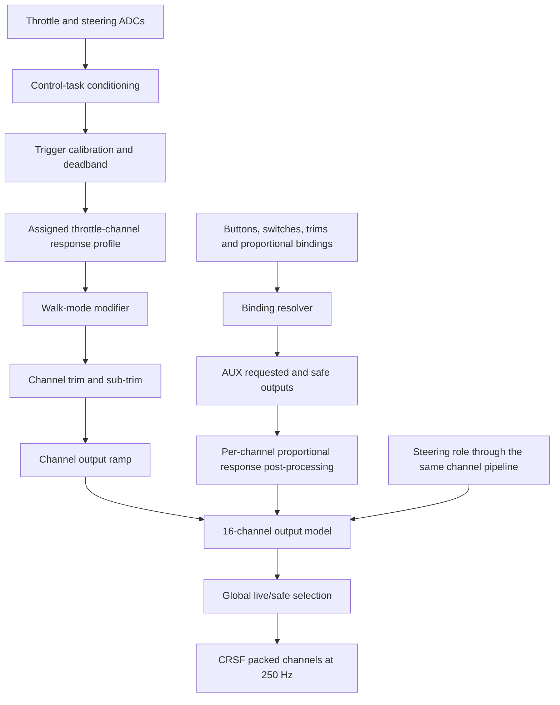
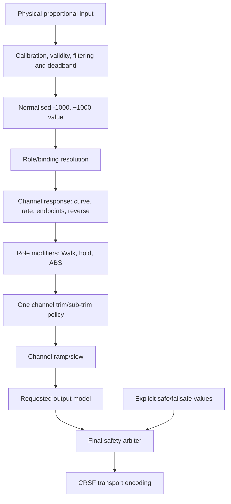

# Control and channel architecture review

Status: active incremental refactor, updated 2026-10-11

## Safety and ownership update — 2026-10-11

The pre-refactor working tree is preserved in commit `4cc5872` on branch
`codex/safety-control-refactor`. This is a recovery checkpoint, not evidence
that the checkpoint firmware is safe to upload.

Three safety gaps are addressed:

- Steering validity is checked even when no explicit mix is configured. Invalid
  proportional inputs cannot contribute live output; invalid channel-role maps
  and mix graphs report `ConfigurationFault`.
- `ControlOutputMailbox` serialises CUT commands and output publication under
  one lock. An in-flight cycle cannot overwrite a newer CUT, publish while an
  edited configuration is pending, or publish an outdated configuration revision.
  CUT does not refresh the sample timestamp.
- Response, sub-trim, role, calibration, binding and mix edits require CUT and
  explicit neutral re-arm. The UI requests CUT before potentially blocking page
  construction or persistence. The engine independently detects structural edits
  and inhibits arming until the arm request is released. Ordinary live trim keeps
  its existing behaviour.

`ControlEngine` now owns input conditioning, slew/mix runtime and link/neutral
qualification. Hardware and SDL provide samples and time to the same engine.
It performs no allocation, persistence, logging or LVGL work. Configuration
contents must be immutable within a revision; every edit publishes a new revision.
Graph validation/topological ordering is cached per structural configuration,
and input validity plus mixed-throttle neutrality share one inspection pass.
Return-link loss after arming remains advisory, preserving the existing policy;
receiver RF-loss failsafe remains a separate protection.

`ChannelModelController` owns channel responses, parameters and mixing.
`ChannelSettingsRepository` persists these in one explicit little-endian,
versioned, CRC32-protected record per model, verifies writes and skips identical
records. A missing record imports legacy response/parameter blobs and mixer
versions 1–4 without writing during load. A present invalid record inhibits output
and never silently falls back to legacy data. Legacy blobs remain intact; older
firmware will read its older settings, not later edits to the new record.

UI channel edits use the controller/repository boundary. Touch response edits
are coalesced and saved after painting, after the gesture ends and output is
acknowledged safe. Portal actions are separated into `transmitter_ui_remote.inc`.
SDL and web builds share `simulator/sources.mk` and track compiler-generated
header dependencies.

This remains an incremental refactor. Interactive calibration, role/binding and
system persistence, display drivers and page lifecycle still have UI ownership.
The two sub-trim stages and transport travel limits retain their current semantics;
changing them needs a separate migration decision.

Validation includes host control/mailbox/codec/migration tests, browser tests,
XIAO portrait firmware compilation, both SDL orientations and full interaction,
rotation, memory and display-cache audits. No firmware was uploaded. Native
performance measurements and their limits are recorded in
[`ui-responsiveness.md`](ui-responsiveness.md).

This review defines the ownership boundaries required before steering, custom
curves, ABS, throttle hold and multiple model profiles are added. Refactoring
must preserve the current transmitted throttle response and the 250 Hz control
deadline; it is not permission for a wholesale rewrite.

## Terms and identities

The following identities are distinct and must not be used interchangeably:

- **Physical input**: a pot, button or switch with a stable hardware ID.
- **Input value**: a calibrated and filtered logical value produced by that
  physical input.
- **Logical role**: steering, throttle or a future named vehicle function.
- **Binding**: a mapping from a physical-input event/value to a function,
  parameter or CRSF channel.
- **Output channel**: one of the sixteen values packed into the CRSF frame.
- **Response profile**: shaping attached to an output channel, independent of
  which physical pot currently drives it.
- **Safety state**: the final authority deciding whether requested or safe
  channel values are transmitted.

## Current runtime flow

The control task runs independently of LVGL. The Arduino `loop()` polls and
dispatches physical inputs, updates the UI and performs settings edits. The
CRSF link task transmits a snapshot of the complete channel model.

## Required target flow

The UI edits a model and publishes a coherent configuration snapshot. It must
not perform response calculations used by the live control path.

## Setting and state ownership

| Data | Correct owner | Current state | Required change |
|---|---|---|---|
| ADC min/centre/max | Physical proportional input | Throttle-owned `ProportionalInput` inside UI | Create one input profile/runtime per proportional control |
| ADC filter and deadband | Physical proportional input runtime | Host-testable `ProportionalInputRuntime`, owned by `ControlEngine` | Retain the shared hardware/simulator path |
| Steering/throttle channel numbers | Model role map | `ChannelRoleSettings` in UI | Move into versioned model configuration |
| Endpoint/rate/expo/reverse/ramp | Output-channel response profile | `ChannelModelController`, explicit versioned persistence; ramp runtime owned by `ControlEngine` | Retain the model/runtime boundary |
| Response curve | Output-channel response profile | Linear + expo only | Add later as a versioned optional curve |
| Trim/sub-trim | Output channel | Two independent sub-trim mechanisms currently stack | Choose one canonical channel-offset stage and migrate values |
| Walk/hold/ABS | Logical drive-role modifier | Walk is throttle-specific in UI | Extract role-aware drive modifiers after unified axes |
| Binding state | Binding resolver/model | Mostly separated | Move persistence into the model profile |
| Requested/safe channel values | Output model | Separated correctly | Retain |
| CUT/failsafe/stale-input decision | Final safety arbiter | CRSF-task arbiter selects the complete requested or safe model immediately before framing | Add model-configurable safe values and mirror them in receiver failsafe settings |
| UI page state | UI only | Channel model and control engine extracted; calibration, role/binding settings and display/page lifecycle still in `TransmitterUi` | Continue splitting focused UI modules |

## Findings and decisions required

### High priority

1. **UI/control-task configuration race — resolved 2026-08-26**

   `TransmitterUi` is edited from `loop()` and read by the 250 Hz control task.
   Individual fields may appear atomic on the ESP32, but unsynchronised C++
   reads and writes are still a data race and a multi-field edit cannot be
   coherent. `ControlConfigurationSnapshot` now captures all UI/model values
   used by the control task and is exchanged as one value under a short
   critical section. The task reads one revision per 4 ms cycle and never
   calls into `TransmitterUi`.

   Cross-task runtime state follows the same ownership rule. Reset requests
   use a monotonically increasing command sequence, so a request cannot be
   lost while the control task is between cycles. Arming/interlock state is
   control-task-owned, CRSF timing/stale state is CRSF-task-owned, and other
   tasks observe both only through coherent snapshots. No cross-task runtime
   flag relies on `volatile` for synchronisation.

2. **Two sub-trim stages**

   `ChannelResponseProfile::subtrimPercent` and
   `ChannelParameterValues::subtrimPermille` are both applied. This can be
   useful only if they have deliberately different names and semantics; at
   present it is an accidental-looking double offset. Preserve behaviour until
   a migration decision is made, then expose one canonical sub-trim to users.

3. **Internal extended travel is lost at transport conversion**

   Response processing and the graph retain +/-1200 so endpoint travel can be
   translated by sub-trim. `crsfValueFromPermille()` currently clamps to
   +/-1000 and maps only to CRSF 172..1811, so the retained outer travel never
   reaches the receiver. Decide explicitly between conventional servo travel
   and extended 0..2047 transport before changing this behaviour.

4. **Different pipelines for throttle, AUX and steering — resolved 2026-08-26**

   `processConfiguredProportionalChannel()` now applies response, role
   modifiers, channel adjustments and slew to steering, throttle and
   proportional AUX values. It produces both requested and statically shaped
   safe values. Walk remains an explicit throttle-role modifier, while final
   live/safe selection remains outside this processor.

5. **Split final safety decision — resolved 2026-08-26**

   The control task previously published a `live` boolean and the CRSF task
   separately suppressed it when the model became stale. The control snapshot
   now carries its reasoned safety status. `arbitrateOutputSafety()` applies
   stale precedence in the CRSF task immediately before frame construction and
   is the only point that selects the complete requested or safe output model.
   Its final status is published back to the UI and diagnostics.

   Detectable transmitter faults continue sending deterministic safe channel
   values. Loss of the S3 or its CRSF serial stream remains the independent
   second layer that causes the ExpressLRS receiver's configured failsafe. A
   future versioned model must store explicit per-channel safe positions and
   guide the user to configure matching receiver failsafe positions.

### Structural

6. **`TransmitterUi` is a subsystem container, not only a UI**

   The active LVGL implementation exceeds 5,000 lines and owns display drivers,
   page rendering, NVS persistence, calibration,
   assignments, drive modes and ELRS management requests. Pure response math
   has now been extracted. Persistence, runtime processing and page modules
   should follow incrementally.

7. **Persistence is fragmented and ABI-dependent**

   Channel responses, parameters and mixes now use an explicit versioned
   record. Remaining settings span several NVS namespaces, including raw C++
   structure blobs whose padding and field layout remain part of their storage
   ABI. Extend explicit serialisation and migration to those model fields.

8. **Historical CH2 names obscure generic behaviour**

   Generic pages and methods still contain `Throttle`/`Channel2` names. Rename
   only while extracting a boundary so reviews can distinguish mechanical
   renames from behavioural changes.

9. **Obsolete alternate UI implementation**

   The non-LVGL `src/channel2_ui.cpp` was excluded from builds and no longer
   matched the public header. It has been removed; Git history remains the
   archive.

## Safety and timing invariants

Every refactor and new feature must demonstrate:

1. CRSF channel publication remains at 250 Hz and never waits for LVGL, NVS,
   I2C display/touch traffic, logging or telemetry parsing.
2. CUT, stale input, invalid ADC, calibration and startup warnings cannot emit
   live throttle demand.
3. Final safety arbitration occurs after bindings, response shaping, mixes,
   modes, hold and future ABS.
4. A structural settings edit or model change forces CUT and neutral re-arm before
   the new configuration can drive the vehicle. Deliberately assigned live trim
   retains its existing behaviour.
5. Channel roles are unique and valid; no output has two unacknowledged writers.
6. Safe values are explicit for every enabled retained channel.
7. UI page changes cannot alter channel output unless the activated control is
   deliberately assigned to do so.
8. Persistence migration either reproduces the previous output exactly or
   forces a clearly reported recalibration/review.
9. Cross-task commands cannot be lost or acknowledged partially; runtime
   state has one writer and is observed only through coherent snapshots.

## Incremental refactor plan

### Agreed execution order

The following is the authoritative order for subsequent refactor work. Do not
skip ahead where a later stage depends on an unfinished ownership or timing
boundary:

1. Validate and checkpoint the bulk telemetry-UART read fix.
2. Replace the dual-UART CRSF bus with a single-UART, deadline-driven
   half-duplex transport modelled on ExpressLRS.
3. Extract and host-test per-channel ramp/slew state.
4. Introduce an immutable, coherently published control-configuration
   snapshot.
5. Connect steering through the generic proportional-input runtime.
6. Route steering, throttle and proportional AUX inputs through one channel
   processing pipeline.
7. Introduce one final output-safety arbiter after all bindings, modifiers and
   channel processing.
8. Move settings into versioned per-model persistence with explicit migration.
9. Decompose `TransmitterUi` into model/controller, display and focused page
   modules.
10. Add custom curves, throttle hold and ABS only after the shared pipeline and
    safety arbiter are established.

At every stage, CRSF channel publication must remain deterministic and must
not wait for LVGL, touch, NVS, I2C, USB logging or telemetry parsing.

### A. Pure channel response — started

- [x] Extract `ChannelResponseProfile`, sanitisation and response math from
  LVGL into `channel_response.{h,cpp}`.
- [x] Preserve existing positive/negative processing order and persisted field
  layout.
- [x] Add host characterization tests for linear response, asymmetric sides,
  expo, reverse, sub-trim, extended clamp and persisted-value sanitisation.
- [x] Extract per-channel ramp state and test time-step/wrap behaviour.

### B. Generic proportional inputs

- [x] Define `ProportionalInputProfile` containing calibration, filter and
  deadband policy, keyed by physical input ID.
- [x] Define `ProportionalInputRuntime` containing only live filter, validity
  and calibration state.
- [x] Move throttle filtering, validity and normalisation out of
  `TransmitterUi`/ad-hoc `main.cpp` code into that runtime without changing output
  samples. The interactive calibration session remains temporarily in the UI
  controller and publishes its accepted calibration through the profile.
- [ ] Move the interactive calibration-session owner out of `TransmitterUi`.
- [x] Publish input profiles to the control task through the coherent model
  snapshot introduced in Stage C.
- [x] Instantiate the same conditioning path for steering.

### C. Coherent model configuration

- [ ] Define a versioned `ModelProfile`: role map, response profiles, channel
  parameters, bindings, drive modes, battery settings and safe values.
- [ ] Replace raw-structure NVS blobs with explicit serialisation and migration.
  Channel responses, parameters and mixing now use an explicit versioned record;
  role/binding/system records remain to be migrated.
- [x] Publish an immutable `ControlConfiguration` snapshot to the control task.

### D. Unified control and safety pipeline

- [x] Resolve every proportional input through one channel pipeline.
- [ ] Extract Walk and future role modifiers from the UI.
- [ ] Resolve the dual-sub-trim and extended-travel decisions with migration
  tests.
- [x] Create and test one final output-safety arbiter.

### E. UI decomposition

- [ ] Make UI callbacks edit model/controller APIs rather than runtime fields.
- [ ] Split display hardware, common widgets, dashboard, channel/response,
  assignment, setup and telemetry pages into focused modules.
- [ ] Retain the semantic page-control registry shared by touch and keypad.

## Test strategy

`make -C test run` builds all pure host tests with warnings treated as errors.
Each extraction must add characterization tests before the old implementation
is removed. Hardware and SDL builds remain required because they validate the
Arduino/LVGL integration that host tests intentionally exclude.
