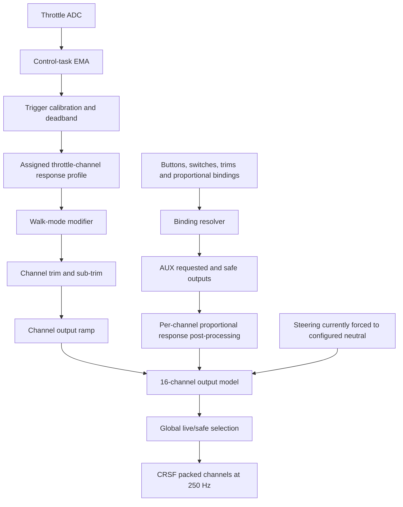
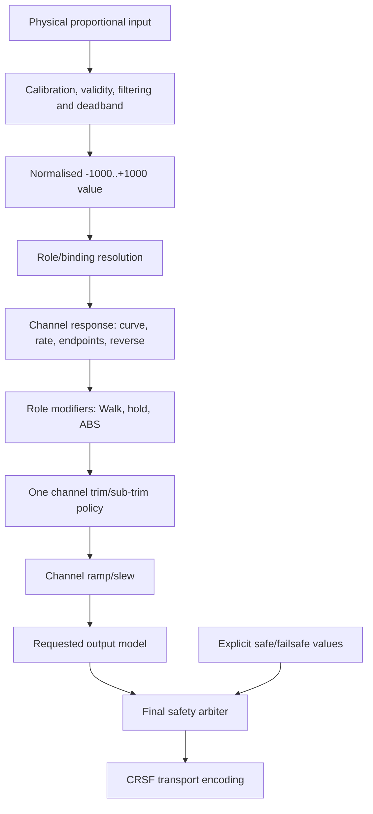

# Control and channel architecture review

Status: initial audit, 2026-08-17

This review defines the ownership boundaries required before steering, custom
curves, ABS, throttle hold and multiple model profiles are added. Refactoring
must preserve the current transmitted throttle response and the 250 Hz control
deadline; it is not permission for a wholesale rewrite.

## Terms and identities

The following identities are distinct and must not be used interchangeably:

- **Physical input**: a pot, button or switch with a stable hardware ID.
- **Input value**: a calibrated and filtered logical value produced by that
  physical input.
- **Logical role**: steering, throttle or a future named vehicle function.
- **Binding**: a mapping from a physical-input event/value to a function,
  parameter or CRSF channel.
- **Output channel**: one of the sixteen values packed into the CRSF frame.
- **Response profile**: shaping attached to an output channel, independent of
  which physical pot currently drives it.
- **Safety state**: the final authority deciding whether requested or safe
  channel values are transmitted.

## Current runtime flow

The control task runs independently of LVGL. The Arduino `loop()` polls and
dispatches physical inputs, updates the UI and performs settings edits. The
CRSF link task transmits a snapshot of the complete channel model.

## Required target flow

The UI edits a model and publishes a coherent configuration snapshot. It must
not perform response calculations used by the live control path.

## Setting and state ownership

| Data | Correct owner | Current state | Required change |
|---|---|---|---|
| ADC min/centre/max | Physical proportional input | Throttle-owned `ProportionalInput` inside UI | Create one input profile/runtime per proportional control |
| ADC filter and deadband | Physical proportional input runtime | Filter in `main.cpp`; deadband partly in UI mapping | Move into one host-testable conditioning stage |
| Steering/throttle channel numbers | Model role map | `ChannelRoleSettings` in UI | Move into versioned model configuration |
| Endpoint/rate/expo/reverse/ramp | Output-channel response profile | Per-channel, but stored/processed through UI class | Pure response module now extracted; publish profiles to control task |
| Response curve | Output-channel response profile | Linear + expo only | Add later as a versioned optional curve |
| Trim/sub-trim | Output channel | Two independent sub-trim mechanisms currently stack | Choose one canonical channel-offset stage and migrate values |
| Walk/hold/ABS | Logical drive-role modifier | Walk is throttle-specific in UI | Extract role-aware drive modifiers after unified axes |
| Binding state | Binding resolver/model | Mostly separated | Move persistence into the model profile |
| Requested/safe channel values | Output model | Separated correctly | Retain |
| CUT/failsafe/stale-input decision | Final safety arbiter | Split between throttle state and global live/safe selection | Make one explicit final arbiter with tests |
| UI page state | UI only | Mixed with control settings in `Channel2Ui` | Split UI controller/pages from model and processing |

## Findings and decisions required

### High priority

1. **UI/control-task configuration race**

   `Channel2Ui` is edited from `loop()` and read by the 250 Hz control task.
   Individual fields may appear atomic on the ESP32, but unsynchronised C++
   reads and writes are still a data race and a multi-field edit cannot be
   coherent. Introduce an immutable control-configuration snapshot exchanged
   under a short critical section or double buffer.

2. **Two sub-trim stages**

   `ChannelResponseProfile::subtrimPercent` and
   `ChannelParameterValues::subtrimPermille` are both applied. This can be
   useful only if they have deliberately different names and semantics; at
   present it is an accidental-looking double offset. Preserve behaviour until
   a migration decision is made, then expose one canonical sub-trim to users.

3. **Internal extended travel is lost at transport conversion**

   Response processing and the graph retain +/-1200 so endpoint travel can be
   translated by sub-trim. `crsfValueFromPermille()` currently clamps to
   +/-1000 and maps only to CRSF 172..1811, so the retained outer travel never
   reaches the receiver. Decide explicitly between conventional servo travel
   and extended 0..2047 transport before changing this behaviour.

4. **Different pipelines for throttle, AUX and steering**

   Throttle has a dedicated safety path, proportional AUX values are shaped as
   a post-process of binding output, and steering is forced to neutral. A
   single pipeline should accept normalised input plus role/channel policy;
   role-specific modifiers should be explicit stages rather than separate
   top-level paths.

### Structural

5. **`Channel2Ui` is a subsystem container, not only a UI**

   The active LVGL implementation exceeds 5,000 lines and owns display drivers,
   page rendering, NVS persistence, response math, ramp state, calibration,
   assignments, drive modes and ELRS management requests. Pure response math
   has now been extracted. Persistence, runtime processing and page modules
   should follow incrementally.

6. **Persistence is fragmented and ABI-dependent**

   Settings span many NVS namespaces. Several records are raw C++ structure
   blobs, so field order, padding and `bool` representation are part of an
   undocumented storage ABI. A versioned `ModelProfile` should use explicit
   serialisation and migration.

7. **Historical CH2 names obscure generic behaviour**

   Generic pages and methods still contain `Throttle`/`Channel2` names. Rename
   only while extracting a boundary so reviews can distinguish mechanical
   renames from behavioural changes.

8. **Obsolete alternate UI implementation**

   The non-LVGL `src/channel2_ui.cpp` was excluded from builds and no longer
   matched the public header. It has been removed; Git history remains the
   archive.

## Safety and timing invariants

Every refactor and new feature must demonstrate:

1. CRSF channel publication remains at 250 Hz and never waits for LVGL, NVS,
   I2C display/touch traffic, logging or telemetry parsing.
2. CUT, stale input, invalid ADC, calibration and startup warnings cannot emit
   live throttle demand.
3. Final safety arbitration occurs after bindings, response shaping, mixes,
   modes, hold and future ABS.
4. A settings edit or model change forces CUT and neutral re-arm before the new
   configuration can drive the vehicle.
5. Channel roles are unique and valid; no output has two unacknowledged writers.
6. Safe values are explicit for every enabled retained channel.
7. UI page changes cannot alter channel output unless the activated control is
   deliberately assigned to do so.
8. Persistence migration either reproduces the previous output exactly or
   forces a clearly reported recalibration/review.

## Incremental refactor plan

### A. Pure channel response — started

- [x] Extract `ChannelResponseProfile`, sanitisation and response math from
  LVGL into `channel_response.{h,cpp}`.
- [x] Preserve existing positive/negative processing order and persisted field
  layout.
- [x] Add host characterization tests for linear response, asymmetric sides,
  expo, reverse, sub-trim, extended clamp and persisted-value sanitisation.
- [ ] Extract per-channel ramp state and test time-step/wrap behaviour.

### B. Generic proportional inputs

- [x] Define `ProportionalInputProfile` containing calibration, filter and
  deadband policy, keyed by physical input ID.
- [x] Define `ProportionalInputRuntime` containing only live filter, validity
  and calibration state.
- [x] Move throttle filtering, validity and normalisation out of
  `Channel2Ui`/ad-hoc `main.cpp` code into that runtime without changing output
  samples. The interactive calibration session remains temporarily in the UI
  controller and publishes its accepted calibration through the profile.
- [ ] Move the interactive calibration-session owner out of `Channel2Ui`.
- [ ] Publish input profiles to the control task through the coherent model
  snapshot introduced in Stage C; the current per-cycle profile copy preserves
  the pre-existing settings race until that boundary is available.
- [ ] Instantiate the same conditioning path for steering after its hardware
  calibration is available.

### C. Coherent model configuration

- [ ] Define a versioned `ModelProfile`: role map, response profiles, channel
  parameters, bindings, drive modes, battery settings and safe values.
- [ ] Replace raw-structure NVS blobs with explicit serialisation and migration.
- [ ] Publish an immutable `ControlConfiguration` snapshot to the control task.

### D. Unified control and safety pipeline

- [ ] Resolve every proportional input through one channel pipeline.
- [ ] Extract Walk and future role modifiers from the UI.
- [ ] Resolve the dual-sub-trim and extended-travel decisions with migration
  tests.
- [ ] Create and test one final output-safety arbiter.

### E. UI decomposition

- [ ] Make UI callbacks edit model/controller APIs rather than runtime fields.
- [ ] Split display hardware, common widgets, dashboard, channel/response,
  assignment, setup and telemetry pages into focused modules.
- [ ] Retain the semantic page-control registry shared by touch and keypad.

## Test strategy

`make -C test run` builds all pure host tests with warnings treated as errors.
Each extraction must add characterization tests before the old implementation
is removed. Hardware and SDL builds remain required because they validate the
Arduino/LVGL integration that host tests intentionally exclude.
