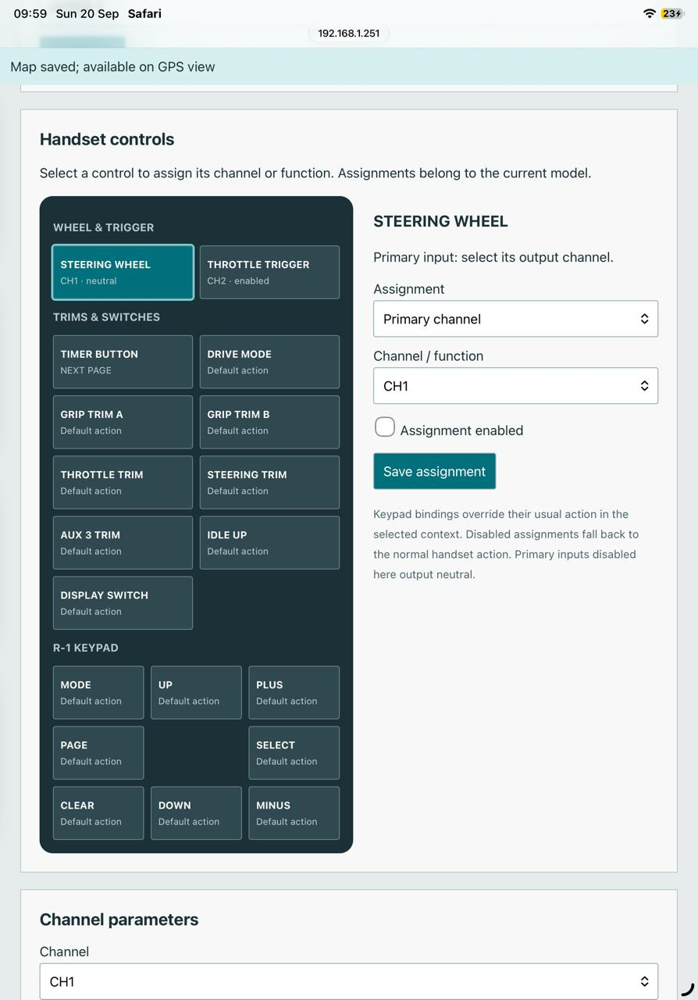
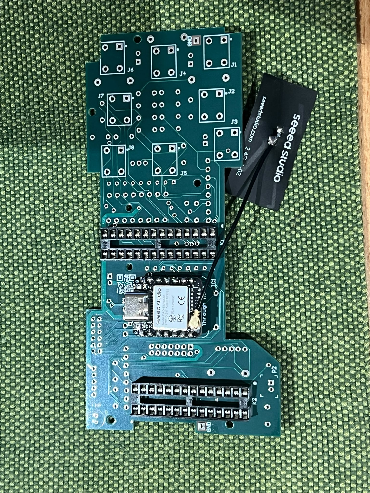
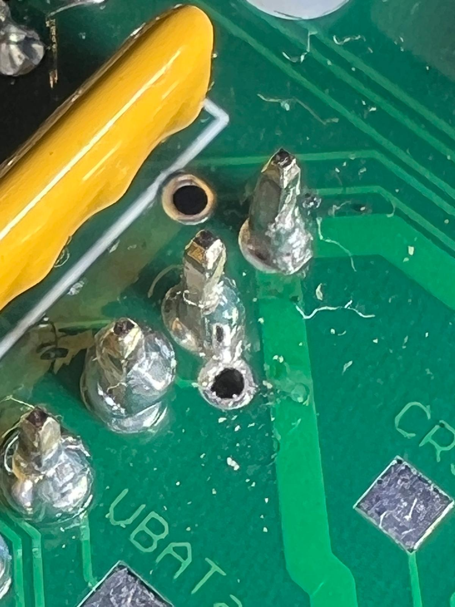

# More of the R-1 EVO build

A selection of supplied development photographs, captures and short videos.
WhatsApp dates below come from the supplied filenames; they are not independently
verified camera timestamps. See [image provenance](../assets/project/README.md)
for the earlier photographs whose capture metadata was available.

## Early throttle setup

An undated early bench photograph shows throttle/brake endpoints, trim,
direction and a live channel indication on the real LCD. The original controls
and external breadboard made it possible to test the control path before the
replacement board was assembled.

## 16 September: manufacture and interface development

| JLCPCB production update | Historical UI capture |
| --- | --- |
|  |  |

The supplied production update shows manufacture in progress, with an estimated
finish of 17 September. The UI capture records the portrait dashboard of that
period, including the earlier CUT and Layout buttons. It is historical, not the
current landscape navigation design.

## 19 September: working RF bench prototype

https://github.com/user-attachments/assets/d969b3ab-47aa-40d7-9dc7-c1d16479c7ca

[Watch the working RF transmission video](../assets/project/video/2026-09-19-rf-bench.mp4).
The opened handset, breadboard, external RF module, display and receiver/servo
setup make the development arrangement visible.

## 20 September: configuration from a browser

The earlier web control editor exposed original handset controls, output
selection and enable state. The modern web UI is shown separately in the
[current interface gallery](ui-gallery.md#embedded-web-ui).

## 22–28 September: assembling and operating the PCB

**25 September — working PCB**

https://github.com/user-attachments/assets/c674a6c4-4e64-43a7-bc6d-176065c3f0c9

[Original clip](../assets/project/video/2026-09-25-working-pcb.mp4).

**28 September — working touchscreen**

https://github.com/user-attachments/assets/dca95e1c-1022-4f89-bfe4-26ae98233780

[Original clip](../assets/project/video/2026-09-28-touchscreen.mp4).

## 25 October: finding the small fault, then testing both inputs

One persistent input problem came from a solder bridge between a grounded
XIAO pin and a nearby via on an input track. It took considerable investigation
to find: the close-up records the eventual physical cause, rather than a
firmware defect.

https://github.com/user-attachments/assets/b78660c5-05b0-463d-b80c-2710eca7bff4

[Original steering/throttle clip](../assets/project/video/2026-10-25-steering-throttle.mp4).

## Media handling

Published JPEG copies omit EXIF/XMP/IPTC/comment metadata. Videos were remuxed
without source metadata or chapters and without re-encoding audio/video. Dates
remain in these captions and filenames rather than embedded location metadata.
The videos document bench milestones; they do not establish every RF failsafe,
electrical or operating condition.
