# R-1 EVO interface gallery

The native screenshots below were captured on **1 November 2026** from the
**real XIAO ESP32-S3**, running firmware **`7d13dbf`**, in landscape 480×320.
The USB screenshot command exports the actual LVGL flush pixels also used by
the handset's web mirror. These are neither simulator frames nor physical LCD
readback: cable/panel faults, viewing angle and reflections cannot appear in them.

The handset remained **CUT**, with the module link paused. Telemetry is the
handset's real current state, including no-data readings; no sensor values were
injected. Temporary artwork, paint and theme examples use the same HYPER 7
model memory, so its name remains visible even when F1 or another image is
selected. Original artwork, paint, theme and timer widget were restored afterward.

## Main screens

| Drive dashboard | Tune |
| --- | --- |
|  |  |
| Data / Sensors | Setup / Model |
|  |  |
| Setup / Handset | Display settings |
| 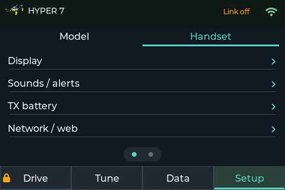 | 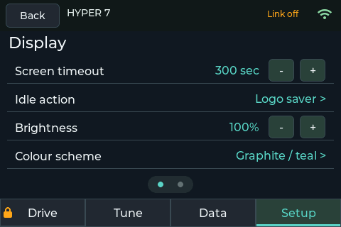 |

## Configuration on the handset

| Control assignments | Channel setup |
| --- | --- |
| 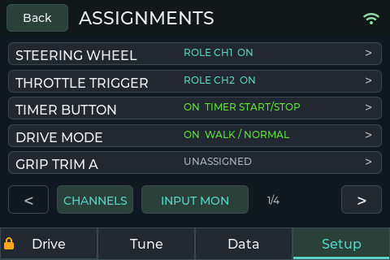 | 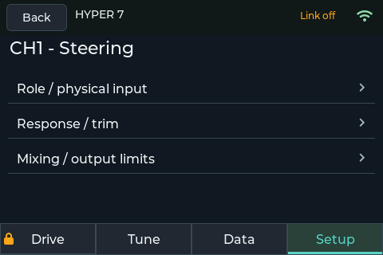 |
| Mixing settings | Mixing response graph |
| 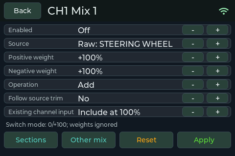 | 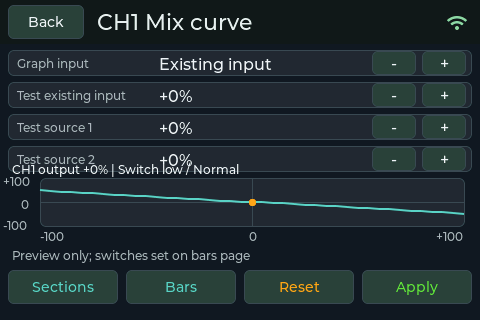 |
| Dashboard positions | Widget settings |
| 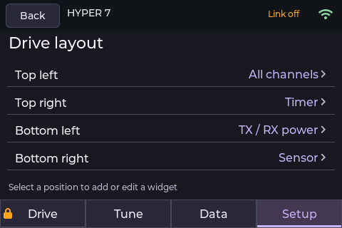 | 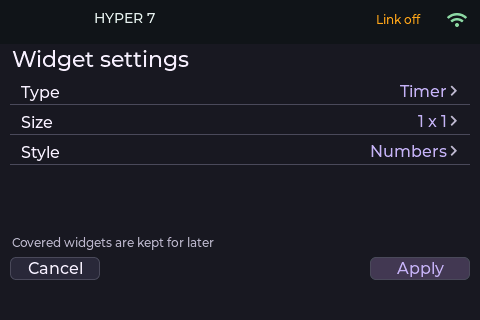 |
| Drive modes | CUT / output status |
| 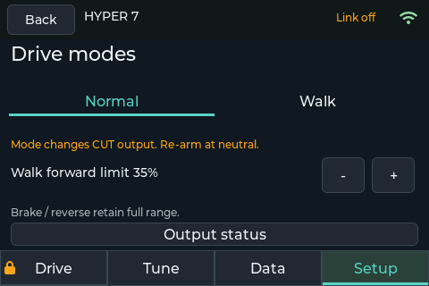 | 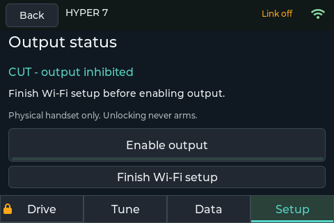 |
| TX battery settings | Live hardware inputs |
| 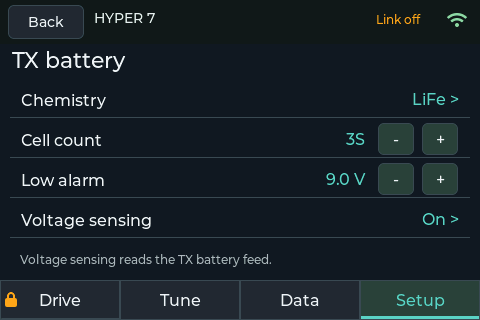 | 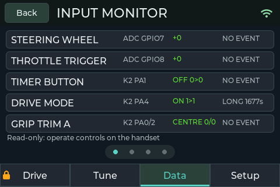 |
| PIN entry | USB PIN recovery |
| 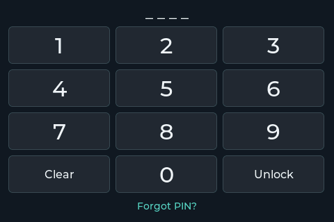 | 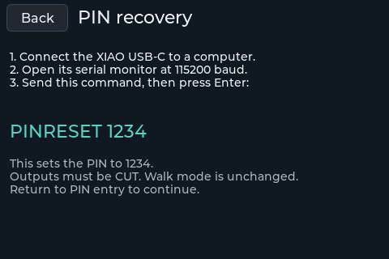 |

Authenticating never enables outputs by itself. The mixing screenshots show
configuration/preview, not a live servo test; existing channel settings were
not changed for the captures.

## Colour schemes

| Light | Graphite / teal |
| --- | --- |
|  |  |
| Midnight / ice blue | Warm charcoal / ivory |
| 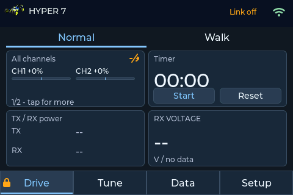 | 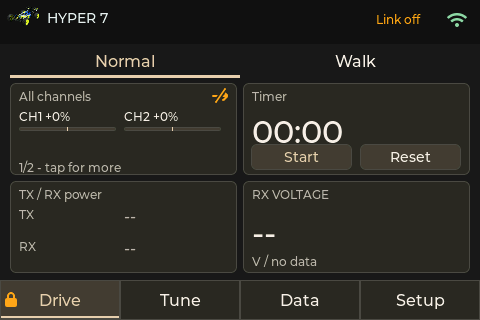 |
| Slate / soft lilac | Scheme selector |
| 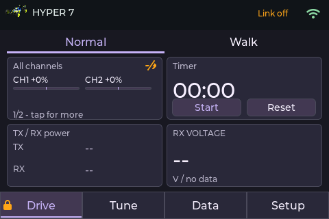 | 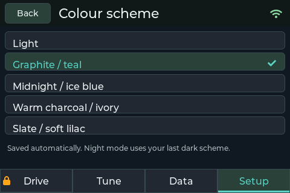 |

## Vehicle artwork and paint

| Hyper 7 | Buggy |
| --- | --- |
|  |  |
| Truggy | Short-course truck |
|  | 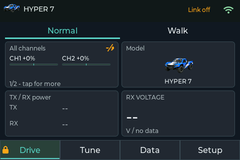 |
| Monster truck | Crawler |
| 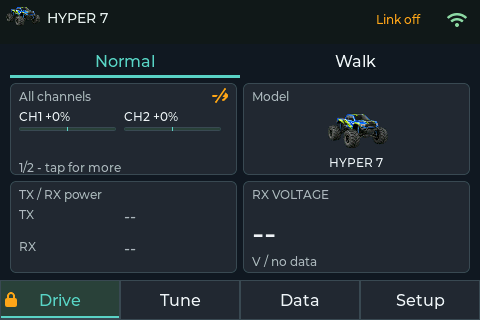 | 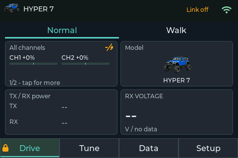 |
| Touring car | Formula / F1 |
| 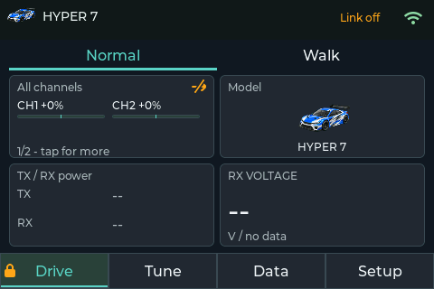 |  |
| Primary, accent and base paint | Recoloured buggy |
| 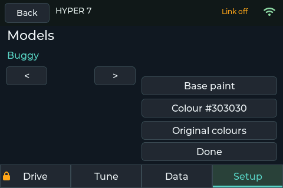 | 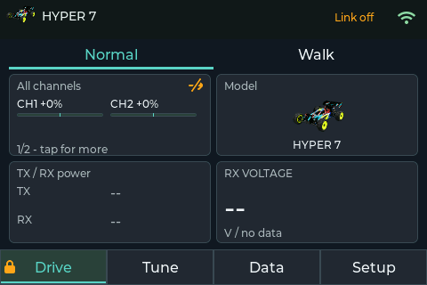 |

These examples use a temporary Model image widget in the original timer's
position. Artwork also changes the small title-bar icon. Tyres/mechanical parts
retain their shading; primary, accent and base paint affect the painted regions.

## GPS illustration from the simulator

This particular image remains a **simulator example**, from checkpoint
`8dda44e`, with a fictional circuit and simulated GPS data. It is deliberately
separate from the real-device screenshots above.

## Complete simulator web page

This is the local simulator browser bridge, including the firmware screen,
eight-key navigation controls, extra Home utility, steering/throttle sliders
and simulated telemetry controls. It is separate from the XIAO's web server.

## Embedded web UI

The following captures use the **actual embedded browser frontend with a local
documentation fixture backend**, not a connected transmitter. The example
network/address, model data and resource figures are illustrative. The map
selector fetched real Esri imagery of Silverstone, a public circuit; the save
confirmation is explicitly a fixture result. No firmware was flashed, no model
was altered and no map was uploaded to physical hardware for these captures.

### Model configuration

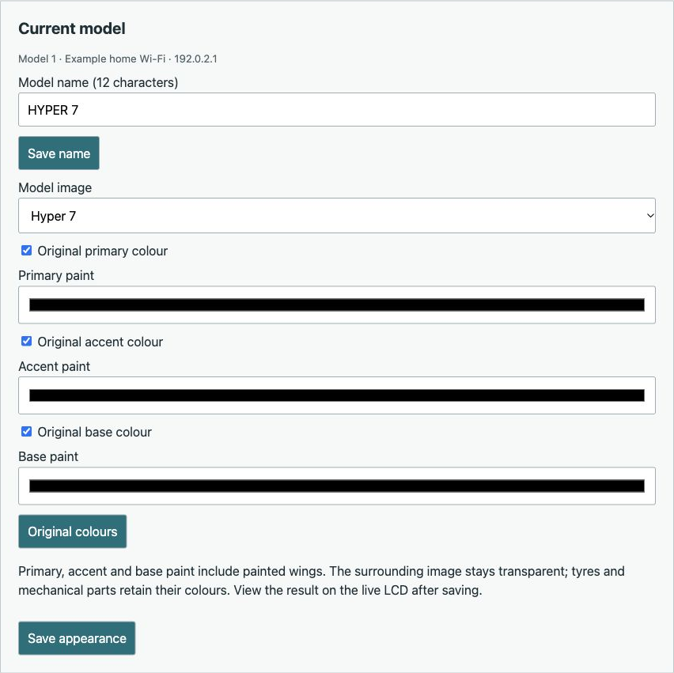

### Original handset controls

The web catalogue includes the original keypad controls. In the current
firmware, reserved keypad navigation takes precedence over editable bindings;
MODE-to-channel remapping needs a further change, as described in the README.

### Select, prepare and upload a satellite map

Choose Street or Satellite, browse/search a location and position the square
selection. **Download selected area** prepares the package in the browser.
Review the handset image and provider credit, then **Save map to handset**.
The two steps are distinct: downloading a preview is not a completed upload.
The screenshot below includes the example save confirmation.

Satellite imagery: **Esri, Vantor, Earthstar Geographics, and the GIS User Community**.
The README's [map acknowledgements](../README.md#map-sources-and-acknowledgements)
also cover OpenStreetMap contributors, Photon/komoot and Overpass.

[Open the full web configuration page capture](../assets/ui-captures/web-portal-full.jpg)
for the complete page, including channel parameters, mixing, maps, memory,
PIN and hostname settings.

## Capture and privacy notes

The native handset PNGs are unchanged 480×320 RGB exports, with only PNG
IHDR/IDAT/IEND chunks: no EXIF, XMP, GPS, device identity or capture-location
metadata. Their [capture manifest](../assets/handset-captures/manifest.json)
records source, dimensions and checksums. No Wi-Fi password or private network
name is visible in the published native screens.

The older simulator/browser-fixture assets retain their own provenance labels.
Their map geography is a public circuit or a clearly fictional track. The
hardware captures do not publish the handset's installed map image.

## Temporary widget focus (simulator)

These examples use the shared UI at firmware `06b6928`, captured on
1 November 2026 with isolated simulator settings and simulated inputs. They
show the saved grid and the expanded All channels, GPS and Timer widgets.
The small top-centre down-chevron restores the unchanged grid. The map has no
live GPS position; the images are not evidence of a GPS fix or physical LCD
appearance.

| Saved dashboard | All channels expanded |
| --- | --- |
| 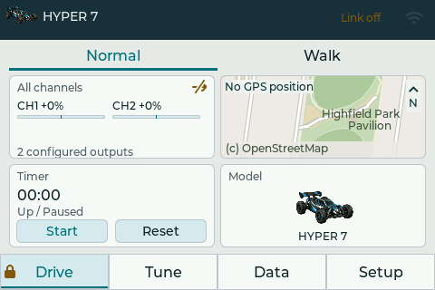 | 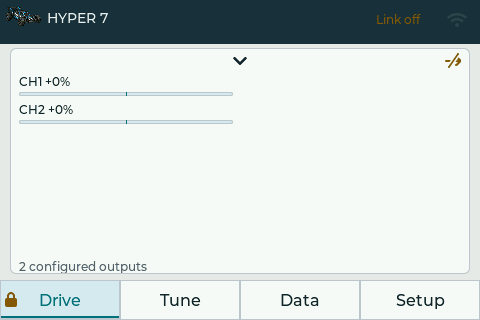 |

| GPS map expanded | Timer expanded |
| --- | --- |
| 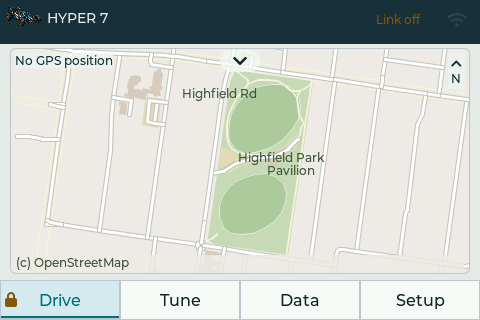 | 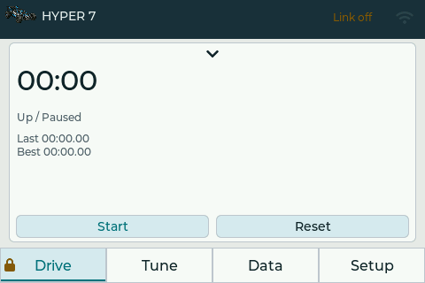 |
