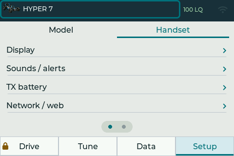
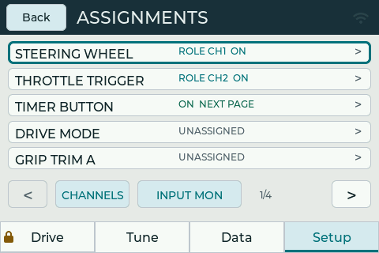
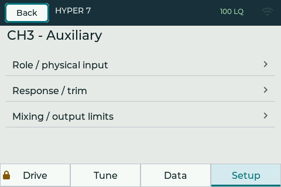
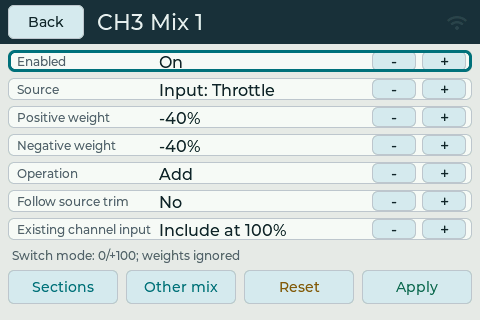
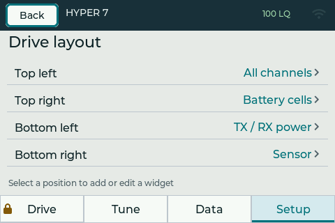
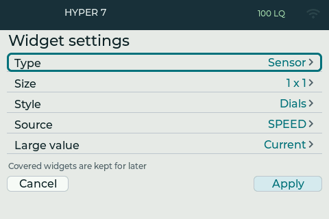
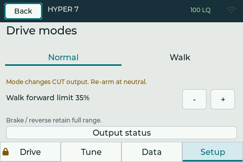
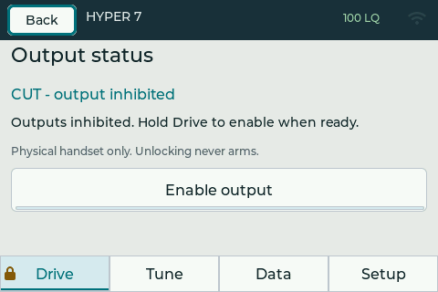
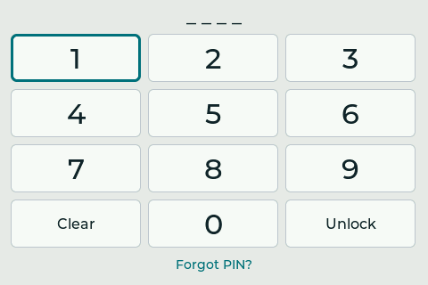

# R-1 EVO interface gallery

These captures illustrate the development UI on 31 October 2026, from firmware
checkpoint `8dda44e`. They are **not fully pixel-perfect reproductions of the
installed LCD**. The native simulator uses the shared C++/LVGL screens; browser
scaling, colours, viewing angle, touch response and update timing differ from
hardware. Telemetry values are simulated and the native GPS circuit is fictional.

## Main screens

| Drive dashboard | Tune |
| --- | --- |
|  |  |
| Data / Sensors | Setup / Model |
|  |  |
| Setup / Handset | GPS map and trail |
|  |  |

## Important configuration screens

| Control assignments | Channel setup |
| --- | --- |
|  |  |
| Mixing settings | Mixing response graph |
|  |  |
| Dashboard positions | Widget settings |
|  |  |
| Drive modes | CUT / output status |
|  |  |

*The PIN keypad is also used for protected operations such as leaving Walk.
Authenticating never enables outputs by itself.*

## Complete simulator web page

This is the local simulator browser bridge, including the firmware screen,
eight-key navigation controls, extra Home utility, steering/throttle sliders
and simulated telemetry controls. It is separate from the XIAO's web server.

## Embedded web UI

The following captures use the **actual embedded browser frontend with a local
documentation fixture backend**, not a connected transmitter. The example
network/address, model data and resource figures are illustrative. The map
selector fetched real Esri imagery of Silverstone, a public circuit; the save
confirmation is explicitly a fixture result. No firmware was flashed, no model
was altered and no map was uploaded to physical hardware for these captures.

### Model configuration

### Original handset controls

The web catalogue includes the original keypad controls. In the current
firmware, reserved keypad navigation takes precedence over editable bindings;
MODE-to-channel remapping needs a further change, as described in the README.

### Select, prepare and upload a satellite map

Choose Street or Satellite, browse/search a location and position the square
selection. **Download selected area** prepares the package in the browser.
Review the handset image and provider credit, then **Save map to handset**.
The two steps are distinct: downloading a preview is not a completed upload.
The screenshot below includes the example save confirmation.

Satellite imagery: **Esri, Vantor, Earthstar Geographics, and the GIS User Community**.
The README's [map acknowledgements](../README.md#map-sources-and-acknowledgements)
also cover OpenStreetMap contributors, Photon/komoot and Overpass.

[Open the full web configuration page capture](../assets/ui-captures/web-portal-full.jpg)
for the complete page, including channel parameters, mixing, maps, memory,
PIN and hostname settings.

## Capture and privacy notes

Native images are lossless 480×320 PNG exports of simulator frames. Browser
captures include a full-page image and section crops for readability. Disposable
state and fixture data were used; passwords and private Wi-Fi details are absent.
The published image files were checked for GPS/EXIF/XMP location metadata.
Maps contain visible geography by design: the documentation uses a public
circuit or a clearly fictional track, not a private home location.
