# JR R-1 EVO User Manual

**Prototype edition 1.3 · 1 November 2026**
For transmitter firmware **06b6928**, installed by verified Wi-Fi OTA on 1 November 2026, XIAO ESP32-S3 / Waveshare LCD (F), landscape.

R-1 EVO retains the original JR wheel, trigger and controls, with a new computer,
colour touchscreen and an ExpressLRS radio link. This guide describes the current
prototype. It is an operating manual, not a wiring or assembly guide.

[Project overview](../README.md) · [Build history](build-history.md) ·
[Screen gallery](ui-gallery.md) · [Printable PDF](../output/pdf/r1-evo-user-manual.pdf)

## Contents

1. [Quick start](#1-quick-start)
2. [Controls and navigation](#2-controls-and-navigation)
3. [CUT, module communication and PIN](#3-cut-module-communication-and-pin)
4. [Models](#4-models)
5. [Drive dashboard and widgets](#5-drive-dashboard-and-widgets)
6. [Channel setup and tuning](#6-channel-setup-and-tuning)
7. [Hardware-control assignments](#7-hardware-control-assignments)
8. [Mixing and switched rates](#8-mixing-and-switched-rates)
9. [Normal and Walk modes](#9-normal-and-walk-modes)
10. [Stopwatch, countdown and lap timer](#10-stopwatch-countdown-and-lap-timer)
11. [Telemetry and GPS](#11-telemetry-and-gps)
12. [Wi-Fi and the web interface](#12-wi-fi-and-the-web-interface)
13. [Offline maps](#13-offline-maps)
14. [Handset settings](#14-handset-settings)
15. [ExpressLRS module settings](#15-expresslrs-module-settings)
16. [Firmware, simulator and service tools](#16-firmware-simulator-and-service-tools)
17. [Troubleshooting](#17-troubleshooting)
18. [Settings and terminology reference](#18-settings-and-terminology-reference)

## 1. Quick start

### Before using a model

Confirm the selected model, channel directions, neutral, travel and receiver/ESC
failsafe before driving. For first setup, disconnect motor power or otherwise make
the vehicle unable to move. CUT is not a replacement for receiver failsafe.

The transmitter and RF module may have separate power feeds in this conversion.
USB power can run the screen without powering the Ranger or producing a detected
TX battery voltage. Follow the installed wiring; do not assume a lit screen means
the RF module is powered.

### Start a normal driving session

1. Power the handset and enter its four-digit PIN. The trial default is `1234`;
   the correct fourth digit submits automatically.
2. Confirm the model name and artwork in the title bar. Select the correct model
   before enabling output.
3. When prompted after TX battery detection, approve **module communication** on
   the handset if you intend to use the radio. Cancel leaves it paused.
4. Power the receiver and confirm a fresh link indication. A high LQ alone does
   not release CUT.
5. Select **Normal** or **Walk** on Drive. Centre the throttle.
6. Hold the **Drive** navigation control deliberately. Observe the progress or
   readiness message, then release as prompted. If output remains CUT, use
   **Output status** to see the reason.
7. Verify steering direction and throttle/brake operation before driving.

### Finish a session

Hold Drive to return to CUT and check its state indicator. Secure/power down the
vehicle before handling it. Switch off module power when RF silence is required.
Lap records are held in RAM: export any records you want to keep before turning
off or restarting the handset.

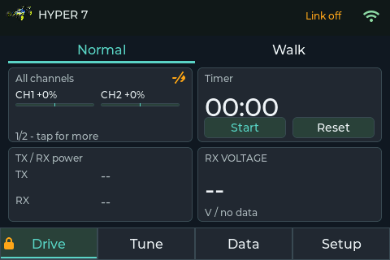

*Most screens in this guide are native rendered captures from the XIAO at firmware
7d13dbf. Widget-focus examples are separately labelled simulator captures at
06b6928. Earlier native captures may differ slightly from the current timer or
widget layout. Neither capture method reads back the physical LCD.*

## 2. Controls and navigation

### The four main sections

| Section | Purpose |
| --- | --- |
| Drive | Widgets, operating mode and deliberate CUT/output-enable action. |
| Tune | Quick steering, throttle and brake response adjustments. |
| Data | Sensors, GPS map, channels and physical input monitoring. |
| Setup | Model configuration and handset-wide settings. |

Tap the bottom navigation control to change section. An ordinary navigation tap
does not enable output. Detail pages provide Back navigation; use their displayed
controls to return to the parent page. Apply/Save and Cancel matter in editors:
leaving an editor is not a substitute for applying its draft.

Where page dots are shown, tap a dot or swipe horizontally to change page. Tabs
select a category within the current section. Paging and tab selection are
separate operations.

The title bar identifies the current model and link/network status, with measured
TX pack voltage immediately left of LQ. Voltage is red at or below the configured
TX warning threshold; `--V` means unavailable. Tap the model
area to reach model selection. Tap the Wi-Fi icon for network status and setup. Hold
the LQ/status area for the module-communication dialog.

### Original programming keypad

| Key | Current navigation action |
| --- | --- |
| MODE | Open Quick menu; hold to return to Drive, except where a modal editor requires finishing/cancelling. |
| PAGE | Next page; hold for previous page. |
| UP / DOWN | Move focus between selectable items; held keys repeat. |
| SELECT / SEL | Activate the focused item. |
| + / - | Adjust the selected editor value; outside editors, select adjacent tabs where supported. |
| CLR / CLEAR | Back; hold in a value editor to request resetting that draft field. Apply is still required. |

From Quick menu, UP opens steering expo, PAGE endpoints, SEL throttle, DOWN trims,
+ models, - timer, CLR Drive and MODE Setup. A first key press used to wake the
screen is consumed rather than also activating a control.

**Current limitation:** the eight programming keys are reserved by navigation.
Although they appear in the assignment catalogue, assigning MODE or another
reserved key as a general channel control does not currently override navigation.
The wheel, trigger, trims and other supported switches use the assignment system.
The original DISPLAY switch is not wired as a XIAO input in this build.

## 3. CUT, module communication and PIN

These are different states:

| State | What it controls |
| --- | --- |
| PIN locked | Access to the handset interface. Unlocking does not enable output. |
| CUT | Live requested channel values are inhibited; safe values are used. |
| Module communication paused | The XIAO stops CRSF channel and management traffic to the Ranger. |
| RF module unpowered | Hardware power is removed from the Ranger. This is the means of guaranteeing it is off. |

**CUT does not mean RF off.** With module communication enabled, safe CRSF channel
frames continue during CUT. Pausing CRSF has not yet been validated as guaranteed
RF silence on the installed Ranger; use its power switch/feed when that matters.

The handset restarts in CUT with module communication paused. A stable sensed TX
battery feed prompts for physical approval to enable communication. Approval does
not arm the outputs. Rebooting or losing the sensed supply revokes that approval;
it is not remembered for the next power session. TX voltage sensing must be On.

### Releasing CUT

Hold Drive, or open **Setup → Model → Drive modes → Output status** and hold
**Enable output**. The readiness explanation is authoritative. Typical blockers
are neutral required, Link wait, invalid inputs/configuration, startup recovery,
a paused module link or an active setup session.

If the message says **Setup session active: close it on the handset to arm**, use
**Finish Wi-Fi setup** on Output status. Leaving the Wi-Fi page also closes a
setup session started by that visit. An existing browser, recovery or firmware
update session is preserved; merely closing a browser tab may not end it.
You do not need to erase Wi-Fi credentials.

Structural changes such as channel/mix edits, model changes and calibration can
force CUT. Recheck the result and deliberately re-enable at neutral afterward.
Loss of return telemetry after arming is currently advisory; actual radio-loss
behaviour is governed by the receiver/ESC failsafe.

### PIN change and recovery

Open **Setup → Handset → System → PIN** for change/recovery options. Follow the
prompts to enter the existing and replacement four-digit PIN. **Forgot PIN?** opens
USB recovery instructions.

For recovery, connect the XIAO USB data port, open a 115200-baud serial terminal,
and send `PINRESET 1234` followed by Enter, substituting your new four digits if
wanted. Outputs must be CUT. Read the success response. Recovery leaves outputs
CUT and does not cancel Walk mode. Physical USB access is therefore a recovery
path, not a security boundary against someone with access to the handset.

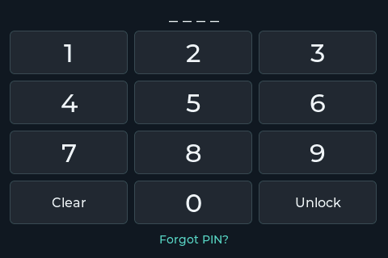

## 4. Models

Tap the title-bar model area to open the model list. A row marked Load selects
that memory; the active row is marked Active. Load a model in CUT with throttle
centred, then verify the active name. Use the separate **Appearance** control to
change the active model's image and paint. Rename the active model in the web UI
(1-12 printable ASCII characters). Do not identify a vehicle by image alone:
multiple memories can use the same artwork.

Artwork choices include Hyper 7, buggy, truggy, short-course truck, monster truck,
crawler, touring car and Formula/F1. Primary, accent and base paint affect
separate image regions; tyres and mechanical shading retain their appearance.
The title-bar icon uses the selected artwork too.

Model settings include channel response/mixes, assignments, dashboard, drive-mode
settings and timers. Display and network settings belong to the handset. Changing
model is not receiver binding and does not automatically prove the selected
receiver/vehicle matches it. Check Model Match/binding separately if used.

## 5. Drive dashboard and widgets

Open **Setup → Model → Dashboard**, select a position and edit its type, size,
style and source. Apply the change. The grid has two columns and two rows:
**1×1**, **2×1**, **1×2** and **2×2** are available where they fit. Enlarging a
widget covers neighbouring positions without deleting their saved widgets;
reducing it reveals them again.

Hold the widget body for about 0.65 seconds and release to maximise it across the
dashboard. The title bar and bottom navigation remain available. Use the small down-chevron overlaid at the top centre,
Back, or another long press to return to the grid. Short taps still open details
or page through entries. Timer Start/Reset buttons keep their own actions; hold
the timer body above them to enlarge it. The saved layout is unchanged. The web
mirror supports the same gesture. The expanded widget omits its own title and extra Restore row to leave more room for data.

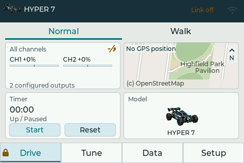

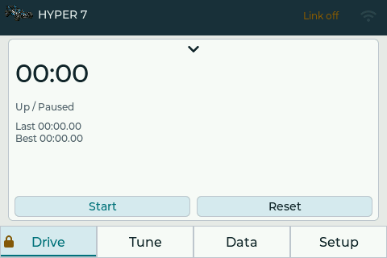

| Widget | Use and options |
| --- | --- |
| Timer | Stopwatch, countdown or lap display. Controls and larger layouts expose session information; tap the title/time area for timer pages. |
| TX / RX power | Local transmitter battery and receiver-supply telemetry. Numeric, bar or dial styles where offered. |
| Channels | One selected channel, optionally a second. Select a suitable numeric, bar, dial, graph or switch style. |
| All channels | Configured outputs, physical controls or both. Choose visible entries; horizontal/vertical bars or numbers, with binary indicators for suitable switch states. Tap to page through entries. |
| Sensor | Speed, RPM, RX voltage, LQ, satellites and drive-pack readings. Styles depend on the sensor. |
| Battery cells | Individual reported cells together, plus total, lowest cell and count. Auto or expected 1S–12S; page when needed. |
| GPS map / speed | Automatically shows the saved map/position/trail or the speed display, based on fresh GPS fields. Acquisition and unavailable data have separate status messages. |
| Drive pack / CU01 | Pack voltage, current, consumed mAh and estimated remaining percentage reported by the CU01. Stale or unavailable readings show `--`. |
| Power / energy | CU01 electrical input power in watts, observed peak watts, accumulated Wh and estimated Wh/km when enough fresh GPS speed data is available. Reset clears these local measurements. |
| Control history | Last ten seconds of calibrated steering and throttle inputs, sampled at 100 ms with fixed -100/0/+100% axes. ST and TH use different colours. |
| Trip computer | GPS distance, moving time, moving average and observed top speed since reset. |
| Run summary | Elapsed time, GPS distance/top speed, CU01 observed peak watts, capacity used and energy used for the same trip session. |
| Battery load / balance | CU01 pack voltage/current, observed minimum pack voltage/peak current, CV01 lowest cell and difference between highest and lowest cell. |
| Speed / motor RPM | Two independent dials for GPS ground speed and sensor-reported motor RPM, with separate units and scales. |
| Controls | Normal / Walk mode controls. |
| Trim / rates | Steering trim/rate and throttle trim/brake rate, with shortcuts to adjustment. |
| RF margin | Current margin above the selected RF mode's sensitivity, with LQ and reported RF output power. |
| Model image | Active model name and painted vehicle image. Tap to reach model selection. |
| Empty | Leave the position unused. |

Speed supports a dial and current/max/average readings; it is not calculated from
throttle position. Tap a sensor for detail/history or power for radio diagnostics.
Choose **Drive pack** in the widget type selector for the combined CU01 card.
Its remaining percentage is the sensor's estimate; the R1 does not establish
the pack's starting charge. A partly charged pack or an incorrect sensor capacity
setting can make that percentage inaccurate. Used mAh is the sensor's counter.

**Power / energy** derives watts from CU01 voltage and current; it does not
measure mechanical motor output. Peak means the highest reported sample, so
short spikes between reports may be missed. Wh is estimated between fresh samples;
stale or invalid intervals are excluded and indicated as gaps. Wh/km is an estimate from
matched power/GPS-speed coverage, unavailable until at least 100 m is covered.
A `~` prefix marks totals that omit telemetry gaps.
These measurements start with fresh data after power-up, model selection or
confirmed Reset. Reset changes local statistics only. Used energy is meaningful
with a partly charged pack; this widget does not estimate its starting charge.

**Control history** shows input commands before expo, trim, channel reversal and
mixing. Positive/negative throttle indicates trigger intent, not whether the
ESC is braking or reversing. Inputs remain visible in CUT; missing, stale or
invalid input intervals leave gaps. The graph does not prove that a servo or
motor followed the command. Both new widgets support the normal dashboard sizes
and hold-to-maximise gesture; a wide Control history card gives more graph space.

**Trip computer** and **Run summary** share one session. It begins at the first
fresh GPS-speed or CU01 reading after power-up, model selection or confirmed
Reset. Either card's Reset clears both cards; it leaves the separate Power /
energy card and sensor counters unchanged. Elapsed time continues while stopped
or telemetry is missing. Moving time and distance use fresh GPS speed, excluding
speed below 1 km/h to reduce standstill jitter. Moving average uses those same
observed moving intervals; it is unavailable until movement is recorded. This
is a resettable trip, not a saved lifetime odometer or an automatic lap detector.

Run capacity is the increase in the CU01's consumed-mAh counter since the first
new reading, so it also works for a partly charged pack. It does not estimate
remaining charge. A counter decrease starts a new baseline and marks the total
incomplete. Missing GPS/power intervals are excluded from distance/moving time/Wh and
marked with `~`; the capacity total may also include sensor-counted use during
a gap. Observed top speed and peak watts remain visible after telemetry is lost.
Short peaks between sensor reports may be missed.

**Battery load / balance** keeps CU01 and CV01 readings separate. Live pack
voltage/current expire after three seconds; cells expire after twenty seconds.
Their missing values show `--`, while observed minimum pack voltage and peak
current remain until reset. Cell spread is the highest reported cell minus the
lowest in the same CV01 packet; it does not diagnose battery health or estimate
internal resistance. Its Reset clears only this card's local observations.
Battery warning thresholds and sensor settings are unchanged.

**Speed / motor RPM** pairs the GPS speed reading with the RB01's reported motor
RPM. Each reading has its own freshness check: a missing RPM feed leaves the
speed dial working, and vice versa. Zero is a valid reading. It displays current
measurements, without deriving RPM from speed or applying a guessed correction.
Confirm the motor's total magnetic pole count and the RB01 Motor poles setting
before treating its RPM as calibrated shaft speed.

With fixed gearing and tyre circumference, motor RPM and road speed are
proportional while the tyres roll without slipping. Wheelspin or tyre expansion
can change that relationship; different sensor delays can also temporarily
separate the readings. The two dials do not calculate a calibrated slip ratio.

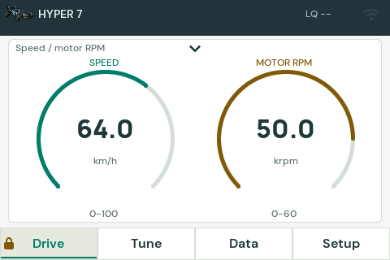

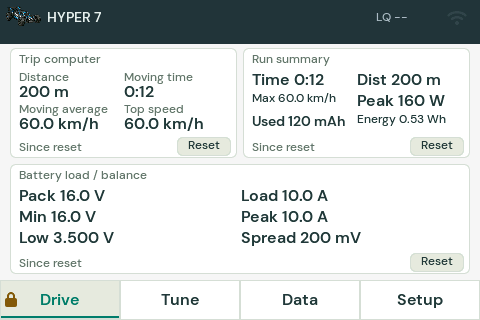

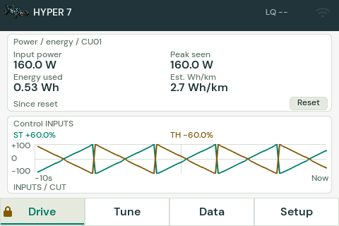

The **GPS map / speed** card chooses its display from the returned data. Fresh
usable coordinates select the map. Fresh speed without position or satellite
fields selects speed; after a usable position was shown, a three-second grace
period avoids switching on a brief interruption. A reported low satellite count
shows **Acquiring**, while position-shaped data without a usable position stays
on the map with a waiting status. Unknown satellites differ from a reported zero.
Some older GPS bridges encode unknown as zero too; fresh non-placeholder
coordinates with zero retain an amber map labelled **Position unconfirmed**.
When telemetry expires, the last presentation remains with unavailable readings.
Speed Max/Avg and Reset use the same statistics as the dedicated Speed card.

This is an automatic display selection, not confirmation of the sensor's physical
mode. The standard CRSF GPS satellite field means satellites in view, not a fix
flag. Even a nonzero count does not establish a usable position. Sensor mode is
only confirmed by its explicit settings reply; the widget does not discover or
configure sensors. The dedicated Speed card stays a speed display, and Data / GPS
remains the full map page.

A stationary hardware comparison on 15 November received populated position,
speed, course and satellite fields in both mapping and freshly confirmed blue
modes, at about 4.7 delivered GPS packets per second. Both feeds therefore select
the map. This does not establish whether coordinates are freshly updated or held,
or the GPS module's internal solution rate. The speed-only examples below use
synthetic packets; they do not represent the captured blue-mode feed.

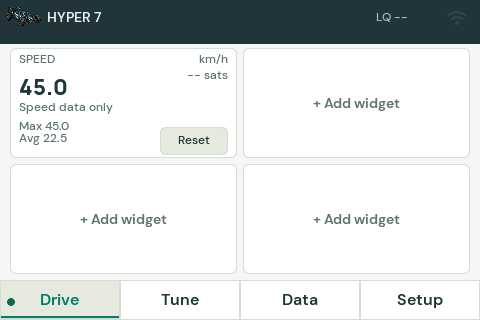

### Monitoring controls while CUT

Channel widgets show requested control values even while CUT sends safe values.
A small crossed-out output indicator marks that condition. Use **Data → Channels**
to distinguish requested values from actual sent values. Moving bars during CUT
are useful for checking wiring/calibration; they do not mean the servo is moving.

In All channels, choose whether to include hardware controls and which entries
are visible. Timer and grip A/B inputs can be shown without assigning an RF
channel. Binary indicators are status displays, not commands to operate switches.

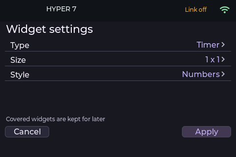

## 6. Channel setup and tuning

Open **Setup → Model → Channels**, page to CH1–16 and select the channel. It has
three groups: **Role / physical input**, **Response / trim** and
**Mixing / output limits**.

### Role, input and calibration

Steering and throttle roles can be moved to suitable free channels. CH1 steering
and CH2 throttle are conventional starting points, not permanent requirements.
An occupied/conflicting channel is rejected. Auxiliary controls are assigned
through Control map; a role's Physical control entry links to its assignments.

Use Calibration / deadband for supported proportional inputs. Follow the on-screen
sequence, moving through the full usable range and returning to the true centre.
Save only after checking the neutral reading. Calibration describes the wheel or
trigger electrically; endpoints limit servo output. Changing endpoints does not
repair a disconnected or incorrectly calibrated potentiometer.

### Reverse steering or another channel

1. Open **Tune**, choose Steering or the relevant response page.
2. Go to the page containing **Direction** and change Normal to Reversed.
3. Apply if the editor presents an Apply action.
4. Test at small travel, then verify both endpoints and neutral again.

For an auxiliary channel, use its Response / trim → Quick adjustments. Reverse
one intended stage; reversing both a control assignment and its channel can
cancel the intended effect.

### Response settings

| Setting | Effect |
| --- | --- |
| Rate | Scales travel/sensitivity for the selected side. |
| Expo | Live response shaping around centre while retaining zero and the selected travel limits. Inspect the curve rather than assuming another radio's sign convention. |
| Endpoint | Maximum negative/positive travel; steering shows physical left/right values. |
| Response speed | Slows changes over the configured time in milliseconds. |
| Direction | Reverses output direction. |
| Trim | Operational offset: moves neutral and endpoints together, clipped to the output range. |
| Subtrim | Centre adjustment: moves neutral while preserving the configured endpoints. Travel on each side is rescaled to meet the new centre. |
| Response offset | Detailed response adjustment where offered. |

Tune provides quick adjustments and **Channel setup** links to fuller settings.
Detailed response separates Right/Left, Forward/Brake or Positive/Negative. Trim
control and Subtrim control entries can select the physical adjuster directly.
In the Expo editor, **+ / −** and Reset take effect live. **Apply** retains the
change; **Cancel** or leaving the editor restores the committed response. Opening
the editor alone leaves an asymmetric saved response unchanged. Return to CUT
before powering off to save. Expo also affects any mixes using that shaped source.
After moving a centre or reversing a channel, recheck mechanical travel for binding.
Steering endpoints can be adjusted live while output is enabled. Open the steering
Endpoint editor, steer left or right (or tap the side), and use the handset
**+ / −** keys to change that side immediately. Reversal is respected. **Apply**
keeps both values without forcing CUT; **Cancel** restores the prior travel.
Return to **CUT after Apply** to save the values to permanent storage before
powering off. Editing never enables outputs if they were already CUT. Throttle
endpoints and other structural response edits except expo retain CUT/re-arm.

Subtrim is limited by the available travel: neutral cannot move beyond an endpoint.
If either side has zero travel, its pinned neutral cannot be adjusted independently.
Steering subtrim can be adjusted live with its assigned control or applied from
Tune. It keeps the configured endpoints fixed and does not interrupt driving.
Return to CUT before powering off to save the adjustment to permanent storage.
Changing it while already CUT never enables output. Throttle and auxiliary
subtrim changes still request CUT; ordinary trim remains a live adjustment.

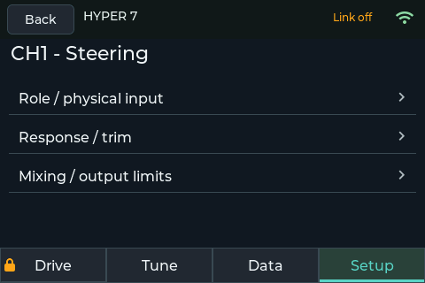

## 7. Hardware-control assignments

Open **Setup → Model → Control map**, or follow a channel's Physical control link.
Select the intended physical control, enable its assignment, select the target
and set its behaviour. Save the assignment. Availability depends on the control
and target; unsupported combinations are rejected.

| Setting | Meaning |
| --- | --- |
| Target | CRSF channel, supported transmitter action, model parameter or drive-mode function. |
| Mode | Proportional, momentary, toggle, two-position, stepped, three-position or pulse where supported. |
| Range / step | Minimum/maximum values and size of each step. |
| Initial / safe state | Starting and safe values where the selected mode supports them. |
| Reverse | Reverse this assignment's control sense. |
| Pulse duration | Duration of a supported pulse action. |
| Context | Restrict where/when the assignment is active. |

Context **Always** applies regardless of screen; **Dashboard** applies on Drive;
**Menus** applies away from the dashboard; **CUT only** applies while output is
inhibited; **Armed only** applies during enabled output. Context does not bypass
CUT or make an unsafe output live. A disabled assignment can fall back to the
control's normal action; it is not always the same as disabling the physical input.

A maintained two-position switch is suited to a binary auxiliary output. A
spring-return trim can step a value or adjust a parameter. Check the live input
monitor first, then check requested and sent channel values. Saved memories may
retain older assignments, so inspect them instead of assuming current defaults.

## 8. Mixing and switched rates

Open the **destination** channel, then **Mixing / output limits**. The destination
is the receiver channel you want to change. The source is the input/channel whose
movement should influence it. Up to two mix contributions are available.

The Sections menu provides **Mix sources**, **Activation**, **Switched rates**,
**Baseline / limits** and **Preview / graph**.

| Mix setting | Meaning |
| --- | --- |
| Enabled / Source | Turn the contribution on and select a raw physical input, channel or configured steering/throttle input. |
| Positive / negative weight | Scale each side of a proportional source; negative weights invert its contribution. |
| Add / Replace | Add to the running mix or replace it at that stage. |
| Follow source trim | Include source trim where supported. |
| Existing channel input | Include the original channel input at 100%, or use mixes only. |
| Constant contribution | Fixed baseline before mix contributions. |
| Final output minimum / maximum | Bound the mixed output. |
| Aux CUT override / value | Auxiliary safe output during CUT; unavailable for steering/throttle roles. |

Activation can be Always, Switch low/high, Walk or Normal. Source mode can be
Proportional or Switch above/below a threshold. Hysteresis prevents repeated
switching near the threshold. Threshold switch modes use their defined switched
contribution; do not expect proportional weights to behave as a gain curve there.

Switched rates use a selected physical switch, separate low/high negative and
positive rates, and a transition time. This is one way to select reduced versus
full authority without repeatedly editing the ordinary endpoint settings.

### Example: reduce CH3 gyro gain as forward throttle rises

This example describes a **gain-channel mix**, not a gyro implemented in the
handset. First establish which CH3 values give the required mode/gain on your
actual gyro. Its centre may divide rate and heading-hold modes; crossing centre
can change mode rather than simply reduce gain.

For a preview example, choose a baseline of +70% and reduce it to +30% at full
forward throttle:

1. Select CH3 as the destination; avoid an unintended additional CH3 assignment.
2. Set Existing channel input to None (mixes only).
3. Set Constant contribution to +70%.
4. Enable Mix 1 with configured Throttle input as source, Add operation,
   proportional source mode, positive weight -40%, negative weight 0% and no
   source trim. Leave Mix 2 disabled.
5. Set final output limits to +30% and +70%.
6. In preview, check neutral gives +70%, half forward gives about +50%, full
   forward gives +30%, and brake leaves the baseline unchanged.
7. Apply and verify the real gyro's behaviour with the vehicle immobilised.

Those percentages are illustrative transmitter values, not a calibration or
recommended gain for every gyro. Verify the forward source sign in preview.

To make a switch select gyro off/on, configure an appropriate switched auxiliary
value or conditional contribution for the same destination, using the gyro's
verified off value. Merely disabling this throttle mix leaves its baseline gain
active. Do not assume a negative gain value means off.

### Preview and resetting

Bars show base/constant, each contribution, mixed and output values. Graph sweeps
the selected input while the other test values remain fixed. Test switch and drive
mode conditions on the bars page. Preview is simulated and does not transmit the
test values. Apply saves; Reset restores the mix draft to defaults and still
requires Apply. Self-references/cyclic channel dependencies are rejected.

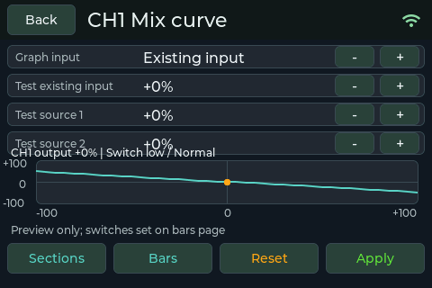

## 9. Normal and Walk modes

Choose Normal or Walk in Drive. Normal uses the model's configured response.
Walk limits **physical forward throttle** to the configured percentage, initially
35%, while retaining configured brake/reverse authority. It is a throttle limit,
not measured cruise control or a guarantee of a particular vehicle speed.

Set the Walk limit under **Setup → Model → Drive modes**. Mode changes force CUT.
Re-enable deliberately with neutral throttle. Leaving Walk requires the PIN;
an idle Walk-exit PIN prompt returns to Drive after about 10 seconds and leaves
Walk/CUT in force. PIN entry never itself arms output.

## 10. Stopwatch, countdown and lap timer

Open the Timer widget's title/time area, or press **MODE**, then **-** in Quick
menu. Timer has **Controls**, **Laps** and **Settings** tabs. Settings belong to
the active model.

| Mode | Main action while running |
| --- | --- |
| Up | Counts elapsed time; main action pauses, then resumes. |
| Down | Counts down from Race / countdown duration; continues as +overtime after zero. |
| Lap | Shows current lap; main action records a lap and starts timing the next one. |

In **Down** mode, the buzzer gives one short beep at **20 seconds remaining**,
two at **10 seconds**, then one at each of **5, 4, 3, 2 and 1 seconds**. At zero
it gives an **800 ms end beep**; the timer continues into overtime. Countdown
cues use the selected buzzer pitch and require both Buzzer and Race-end alarm to
be On. A short countdown uses only the milestones within its duration. Pausing
stops a pending sequence; resuming does not replay passed cues. Reset or Ready
starts a new countdown sequence. Sound scheduling does not block the control loop.

In Lap mode, the initial action is Start. Use the separate Pause action when you
want to stop timing rather than record a lap. Resume excludes time spent paused.
Reset stops/zeros the clock but **keeps recorded laps**. Clear laps is separate,
requires confirmation, and is allowed only when paused and not Ready.

### Record a race

1. Choose Lap in Settings and set Minimum lap to reject accidental rapid presses
   (default 3 seconds).
2. Set Race / countdown duration, Race-end alarm and optional Target lap alarm.
3. Start from Controls or the timer's assigned physical button.
4. Press Lap on each crossing. Accepted laps beep; too-short laps are ignored.
5. Pause after the session, review Laps and export before power-off if needed.

Up to **100 laps per model per power session** are held in RAM. Laps shows records
and marks the best; summaries include last/best/average/total. At capacity, further
laps are not stored until you pause and clear. Settings and accumulated on-time
are saved; lap records and running clock are not restored after reboot. On-time
is checkpointed about once a minute, so abrupt power loss can lose the latest
fraction of that accumulated figure.

### Ready: throttle auto-start

Enable Throttle auto-start in Settings, then deliberately press Ready. Centre
throttle, then apply forward throttle (about 10% or more) to start timing. Invalid
inputs or locked/calibration/recovery conditions prevent a valid start. Ready
resets the clock while retaining lap records. Enabling auto-start alone does not
put the timer into Ready. **Starting a timer never releases CUT or enables RF.**

A new default timer-button assignment starts/pauses Up/Down and starts/records
Lap mode. Existing saved assignments are preserved. Control map also offers
supported timer actions such as Lap, pause/resume and Ready. The web timer panel
provides settings/actions and lap CSV download; web writes require CUT access.

## 11. Telemetry and GPS

Use **Data → Sensors** for values and histories, **GPS** for location/trail,
**Channels** for requested/sent outputs and **Inputs** for physical controls.
No data or stale values mean no usable fresh measurement; they are not zero.

Link data can include LQ, RSSI and SNR. Other supported readings include receiver
voltage, speed, GPS/satellites, RPM, temperature, pack/cell values and FAS
voltage/current, when supplied by compatible receiver firmware and sensors.

GPS status distinguishes reception from fix quality:

- **Waiting for GPS telemetry:** no usable GPS report is available yet.
- **Fix unknown:** fresh usable coordinates have arrived, but standard S.Port GPS
  does not provide an explicit fix-quality field or satellite count.
- **GPS stale / no fix:** position data is absent or older than the freshness window
  (three seconds). The dashboard can show **No GPS position** before any usable
  trail point has been accepted. A 0,0 unknown-fix placeholder is not plotted.

Do not treat an empty satellite display as proof that no S.Port GPS data is
arriving. Check the position, speed and freshness together.

### Which battery is being displayed?

| Reading | Measurement |
| --- | --- |
| TX | Local handset pack via its voltage-divider input. It is not USB/5V_SYS voltage. |
| RX | Receiver supply/BEC telemetry. |
| Drive pack / cells | Vehicle battery measurements from a compatible sensor. |
| FAS voltage/current | Measurements from the FAS sensor; not automatically the same as RX supply. |

Battery cells can use Auto or an expected 1S–12S count. An expected count does not
create missing data or divide total voltage into measured cells. The receiver cell
trial currently forwards 4S; larger display capacity is not proof of validated
6S/12S receiver support.

The custom receiver adds S.Port support. The GPS-forwarding trial firmware was
uploaded to the ER6G on 1 November 2026; live GPS delivery still needs confirmation. A sensor branded RadioMaster/ERS is not necessarily
an S.Port sensor; match its protocol and receiver firmware rather than selecting
by brand. Receiver wiring/output mapping remains separate from transmitter mixing.

A map can be viewed without GPS; a live position/trail requires valid position
telemetry. The GPS page keeps its title bar, navigation and controls visible
while idle; automatic fullscreen is disabled for this trial.
Use Zoom -/+, Trail and Reset trail as needed. Attribution remains part of the map.
Dashboard GPS widgets crop saved satellite imagery to fill their area, including
when maximized. While the location is inside the saved map, following stops at
the image edges so it does not expose blank margins. The position and trail keep
their true geographic placement. The separate GPS page retains its zoom controls;
an outside-coverage position still needs a map covering that location.
Dashboard widgets omit the source-credit strip; open Data / GPS for map credits.

## 12. Wi-Fi and the web interface

### Connect to home Wi-Fi

Open **Setup → Handset → Network / web → Home Wi-Fi**, or tap the Wi-Fi icon.
Viewing status or checking the IP address does not start a setup session or
request CUT. Choose **Start setup**, or a network/configuration action, when you
want to make changes; that starts setup and requests CUT. Leaving the Wi-Fi page
ends the session started by that visit. A session already active for browser
configuration, recovery or a firmware update stays active until finished safely.

Select/enter the network and password and connect. Cancel discards an editor's
unapplied draft. Password characters are visible
in the current setup editor. Saved credentials and optional automatic connection
are retained; with auto-connect On, attempts begin after boot without opening setup.
The icon is a shortcut/status indication, not proof that every web request works.

Find the actual address and web credentials under **Web access**. Use its numeric
IP if the local hostname does not resolve. The installed prototype is currently
reserved at `http://192.168.1.251/`; another installation/network may differ.
The hostname can be changed through the network/web settings; use the displayed
active name/address after applying or restarting.

### Hotspot and authentication

If needed, enable the setup hotspot from the LCD and join it from your computer or
phone. Read its displayed address/credentials. Home Wi-Fi and hotspot access are
different network paths. A browser may need internet access separately to download
map imagery/search results.

Web authentication uses username **r1** and the handset's displayed web password.
It is separate from the four-digit PIN. Authenticated configuration may be used
while the LCD PIN is locked. The live mirror also accepts PIN entry. Do not share
a URL containing test login credentials; use the normal login workflow where the
client supports it. This guide deliberately includes no installation password.

### Live screen and configuration

Open the live handset screen to view the current rendered LCD pixels and operate
the menus. The mirror is native 480×320 in landscape; browser zoom can change its
apparent size. It is separate from the desktop simulator. Touch/hold gestures
should be performed on the mirrored screen as on the LCD.

Configuration and remote writes are restricted by authentication, session checks
and CUT state. Physical approval for module communication remains a handset action.
Remote PIN entry does not override that requirement or output readiness.

The page includes channel parameters, control mapping, mixing/preview, timer
settings/actions/export, maps, network options, restart and firmware update.
Use each section's Save/Apply action and read its response; changing a field
alone is not proof it was saved. Finish an explicit setup session on the handset
before attempting to enable live output.

## 13. Offline maps

The browser prepares a map package and transfers it to the handset. It is not a
continuous map-streaming service to the LCD.

1. Open the web map selector and search an address/place.
2. Choose Street (OpenStreetMap) or Satellite (Esri), then pan/zoom to the area.
3. Check the **square download area**. Download selected area creates the browser
   preview; it has not yet saved to the handset.
4. Review the preview, name and attribution. Current image packages are limited
   to 512×512 pixels.
5. If storage is unavailable, use **Prepare map storage** and its confirmation;
   wait for an explicit result. Storage preparation is not map upload.
6. Choose **Save map to handset**. Wait for a success message, not just upload
   progress or “waiting for handset to validate and save”.
7. Open the handset GPS page/widget to check the installed map.

Export map package saves a reusable package to your computer; Import accepts a
supported package for transfer. Download handset map retrieves the installed one.
A prepared browser preview and the installed handset map can be different.

Persistent storage holds the saved package; PSRAM is working memory used to draw
it and is lost on power-off. A larger download can exhaust package/storage limits.
If “Invalid setup session” appears, refresh/re-authenticate, confirm CUT, and retry;
a stale browser session is not proof the map data is invalid.

Map credits must remain attached: street data © OpenStreetMap contributors;
satellite imagery credits include Esri, Vantor, Earthstar Geographics and the GIS
User Community as supplied by the imagery service. Search uses Photon. Preserve
the package's actual source attribution when exporting/sharing.

## 14. Handset settings

Open **Setup → Handset** and page for additional entries.

| Area | Main settings |
| --- | --- |
| Display | Screen timeout, idle action (logo saver/display off), brightness, colour scheme, activate now and orientation. |
| Sounds / alerts | Available sound and alarm options. |
| TX battery | Chemistry, cell count, low alarm and voltage sensing. The installed pack is 3S LiFe. |
| Network / web | Home Wi-Fi, auto-connect, setup access, web address/credentials and hostname. |
| System | Input diagnostics, firmware information, PIN and restart. |

Orientation changes reflow the UI between portrait and landscape; they are a
manual test/control, not accelerometer-driven rotation. Perform changes while
CUT and finish any active editor/hold first. The installed default is landscape.
The logo saver alternates JR PROPO and R-1 EVO. Touch or a navigation key wakes it;
the wake action need not also operate the underlying control.

TX battery settings describe the sensed **raw pack feed**, even if the computer
itself runs from USB or a separate 5V regulator. If that feed is absent, no TX
battery reading can be inferred from the power source. Choose appropriate alarm
settings for the actual chemistry rather than copying LiPo values into LiFe.

Restart reboots in CUT and clears RAM session data such as lap records. It does
not deliberately erase saved models, maps or Wi-Fi. Export lap records first.

## 15. ExpressLRS module settings

Open **Setup → Model → RF module** with module communication approved and the
Ranger powered. Discovery reads the module's own parameter tree. Available choices
depend on its firmware; a missing option is not added by the handset.

Open folders, select a value, then Apply. Wait for readback before assuming the
module accepted it. Typical advertised options include packet rate, telemetry
ratio, Model Match, maximum power and Dynamic power. **Dynamic** lets the module
vary transmit power according to its link logic, subject to the configured maximum;
it is not a channel mixing or Walk-mode setting.

Command entries may require Run command then Confirm. Module Wi-Fi can interrupt
the normal RF/CRSF link; reconnect and Refresh to establish its actual state.
Binding phrase/UID support has its own workflow/version requirements. Numeric or
string parameter types that the current editor does not support are read-only.
The receiver needs compatible settings to reconnect after RF changes. See the
[RF configuration notes](elrs-tx-configuration.md) for protocol details.

### ABS pulsed braking

Open **Tune → Brake → second page → ABS braking**. This is timed pulsed braking,
not wheel-lock sensing. It is **Off by default** and is supported only with the
ESC set to **Forward/Brake**, with reverse disabled.

First use the ESC programmer to read its settings, set **Run mode → Fwd/brake**,
and wait for verified write/readback. Alternatively read an ESC already set to
that mode. Return through Drive and its required power cycle. The ABS page then
shows the last verified **Forward / Brake** setting and allows ABS to be enabled.
No ESC setting is changed automatically by this page. Verification is saved per
model; if the ESC is changed using a card or another transmitter, re-read its run
mode before relying on ABS. It is a record of configuration, not live ESC-state
feedback. Beginning another programming session clears verification and turns
ABS off; re-enable it explicitly after verifying the mode again.

| Setting | Meaning | Default |
| --- | --- | --- |
| Activation | Physical brake-trigger travel required to start the delay | 30% |
| Brake release | Reduction from requested braking during the weaker half of each pulse | 30% |
| Pulse frequency | Complete strong/weak cycles per second; 2–10 Hz | 5 Hz |
| Delay | Initial continuous braking before pulsing; 0–1000 ms | 200 ms |

The pattern has 50% strong and 50% reduced braking. A 30% release means a 100%
brake request alternates with approximately 70%, subject to response settings.
ABS follows response/mixing/trim/ramp processing, affects only the throttle
output on the physical brake side, and never creates forward drive during its
release half. CUT, invalid inputs, configuration errors and stale-control safety
still override it. Changing ABS settings requests CUT and normal re-arming.
An **ABS** marker in the header indicates it is enabled, not necessarily pulsing.

The initial implementation has host/simulator coverage; actual ESC braking and
receiver PWM must be bench-validated before driving with ABS. Keep ABS off in
Forward/Reverse/Brake mode: a brake-side trigger alone cannot distinguish braking
from reverse. Steering-dependent ABS and switch activation are not included yet.

### ESC programming (custom ER6G)

The current bench-tested implementation uses custom ER6G r14/r8 firmware and
the normal ESC lead on receiver output 5. It does not require an ER4 or CH12
selection. Stock receiver firmware does not provide this interface. Program,
Read ESC and Drive stay visible across the ESC tabs; unavailable actions are dim.

Keep CUT active throughout configuration. For bench commissioning, disconnect
the motor leads and remove the programming card before using the R1:

1. Open **Setup → Model → ESC settings**. Select **Program** and wait for
   **“Cycle ESC power for programming; stay CUT.”**
2. Switch the ESC off with one continuous long press of its power button,
   holding until the receiver LED goes completely dark. Wait five seconds,
   switch the ESC on **once**, and leave it on. If the ESC button
   does not remove BEC power, disconnect the drive pack; after reconnecting it,
   press the ESC power button once if needed to enable its BEC. A second restart
   consumes the one-shot request and returns the receiver to normal Drive.
3. Wait for **“Programming ready; Read ESC,”** then select **Read ESC**. After all
   15 settings arrive, choose a setting on Drive, Brake, Motor or Limits. Adjust
   its draft and select **Apply one**. Success means an ESC acknowledgement and a
   matching readback; the handset displays **“Setting saved; readback verified.”**
4. Select the **Drive session button** above the bottom navigation bar, then
   restart ESC/receiver power using the same off/five-second/on procedure. Wait
   for **“Drive confirmed; outputs remain CUT.”** Returning to Drive never arms
   the transmitter automatically.

The paired startup stage is required for the measured ESC entry window. A
single-application trial started too late. Writes are individual transactions
with no automatic retries; loss of the link or an uncertain reply retains the
CUT interlock. The drag-brake 0% → 5% → 0% bench test passed; the 5% value was
also confirmed after a power cycle with the programming card. This does not
claim validation of every setting or every ESC model. Earlier ER4 experiments
are retained in the [commissioning history](esc-programmer-er4.md).

## 16. Firmware, simulator and service tools

### Firmware updates

Use the documented local build/test workflow for this installed XIAO/Waveshare
board. USB upload uses PlatformIO and its hardware/branch preflight, including when
a Pi is used only to receive the binaries and flash over USB. Do not substitute a
diagnostic or different-board image for a normal update.

The web firmware updater accepts a targeted **.r1ota package**, produced by
`tools/package_ota.py`, rather than an arbitrary binary. Authenticate, keep outputs
CUT, choose the package and wait for validation/restart before reloading. Do not
interrupt power. An end-to-end authenticated Wi-Fi update to **06b6928** was
verified on 1 November 2026, including validation, reboot and web-interface
availability. Saved models, maps and Wi-Fi settings were retained. Wi-Fi
availability still depends on signal and network conditions.

The updater checks target, size, image header and transfer checksum before
selecting the inactive application slot for restart in CUT. An interrupted or
rejected upload leaves the current application selected. Web authentication is
required; the checksum is not a cryptographic firmware signature. Use a trusted
network. USB remains the recovery route and is required for bootloader or
partition-layout changes. An update is not a substitute for checking model
response before the next drive.

For the installed landscape profile, the guarded command-line updater uses
`JR_R1_OTA_URL=http://HANDSET-IP` with
`.venv/bin/pio run -e seeed_xiao_esp32s3-pcb -t upload`.
Replace HANDSET-IP with the actual address. Enter the web password when prompted;
do not publish it in a URL or script. This path retains the upload preflight.

### Desktop/browser simulator

The simulator runs shared firmware UI code with simulated controls and telemetry.
Use it to learn menus, explore layouts and test draft settings without hardware.
Its model/state and sensor fixtures are separate from the handset and are not
transferred automatically. Font rendering and display appearance may differ from
the physical LCD. See [Development guide](../DEVELOPMENT.md) for launch commands.

Both portrait (320 × 480) and landscape (480 × 320) layouts are maintained and
checked in the simulator. **Setup → Handset → Display → Orientation** changes
the display orientation. Automatic rotation is not implemented; it would require
an accelerometer and orientation-detection firmware in a future revision.

### Serial diagnostics

At 115200 baud with newline after commands, `BOOTLOG` retrieves recent startup
results, `MEMORY` reports internal RAM/PSRAM and task stack margins, and `INPUTMON`
opens the input monitor. `WIFISTATUS` reports network access details and may expose
credentials; do not publish its unredacted output. Close a serial monitor before
flashing if it holds the USB port.

### Display comparison

The authenticated web page includes a **Display comparison** section for bench
testing Standard and Trial screen-transfer methods. Keep the handset unlocked,
awake and CUT, with holds released, before changing the method. Restart always
restores Standard. This setting does not change the LCD clock or driving setup.
Let the first redraw finish, reset the display counters, then repeat the same
navigation with each method. Initial full-redraw testing showed no clear Trial
speed gain; Standard remains the default. Broader performance/stability still
need validation; see [UI responsiveness](ui-responsiveness.md).

A native screenshot export is available over USB/web rendering. It does not read
back display glass, so a good capture cannot rule out LCD wiring or panel faults.

## 17. Troubleshooting

| Symptom | Checks / action |
| --- | --- |
| Hold Drive has no effect or stays CUT | Open Output status. Check active setup session, module approval, neutral, fresh inputs/link and startup status. Use the larger Enable output control to check hold recognition. |
| Setup session active | Finish Wi-Fi setup on the handset. Closing the browser alone may leave the session active. |
| Link wait | Check receiver/module power, compatible binding/RF settings, module approval and fresh telemetry. |
| Screen works but TX voltage is missing | Check Voltage sensing On and the raw TX battery sense feed; USB/5V_SYS alone need not supply it. |
| Bars move while CUT, servo does not | Expected for requested-value widgets. Check Data sent values; enable only after readiness checks. |
| Wrong steering direction | Change the channel's Direction, then check neutral and both endpoints. |
| Input shows active with nothing connected | Inspect input monitor and PCB pull-ups/solder bridges. Calibration cannot repair a grounded digital input. |
| Web server times out | Check antenna/power and Wi-Fi status. Try the displayed numeric IP and refresh authentication. A Wi-Fi icon alone does not prove the server is reachable. |
| Invalid setup session on save | Refresh/authenticate to obtain a current session; remain CUT, then retry. |
| Map preview changed but handset map did not | Download prepares the browser preview; Save map to handset and success confirmation are separate. |
| Battery cells missing | Check actual sensor protocol/receiver forwarding and freshness. Expected cell count does not synthesise cells. |
| No GPS trail | Confirm receiver GPS forwarding, valid location/fix and fresh telemetry; a saved map alone provides none of these. |
| Timer press ignored | Check assignment/context, mode, minimum-lap interval and 100-lap capacity. |
| Laps disappeared after restart | Expected: lap history is session RAM. Export CSV before restarting. |
| Blank LCD but web/serial works | Separate backlight from graphics. Check LCD power, CS, reset, DC, clock and MOSI connections; touch uses I2C separately. Use the installed pinout guide. |
| Cannot exit Walk | Enter the correct PIN within the prompt; otherwise it times out back to Drive. Use USB recovery if the PIN is forgotten. |

## 18. Settings and terminology reference

| Term | Meaning |
| --- | --- |
| Requested | Control/mix value before safety substitutes a safe output. |
| Sent | Value actually submitted to the channel transport; can differ during CUT. |
| Role | Steering or throttle function assigned to a channel. |
| Assignment | Association of a physical control with an output, action or parameter. |
| Endpoint | Output travel limit; distinct from physical-input calibration. |
| CRSF | Handset-to-module channel/management/telemetry communication. |
| ExpressLRS | RF link firmware/system used by the Ranger and receiver. |
| S.Port | Sensor telemetry protocol supported by the project's custom receiver work. |
| LQ | Link-quality telemetry; not an output-enable switch. |
| PSRAM | Volatile working memory, not permanent map storage. |

**Scope of this edition:** checked against transmitter firmware 06b6928. The installed
hardware is the custom R-1 PCB with XIAO ESP32-S3 and Waveshare 3.5-inch RPi LCD (F).
Receiver firmware/sensor capabilities are separate and should be checked for the
actual receiver build. This manual makes no claim that every sensor, RF setting
or prototype menu has completed hardware validation.

R-1 EVO is independent handset firmware, not an OpenTX/EdgeTX fork. ExpressLRS
provides the radio link. JR PROPO's original R-1 hardware/manual, sourceTX and
other radio interfaces informed the project; see the project README for credits
and the separate build history for its development story.
